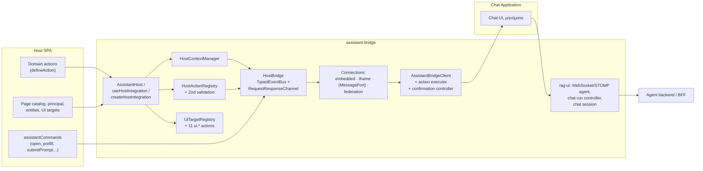
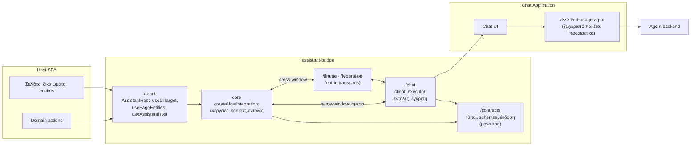

# assistant-bridge — Έλεγχος αρχιτεκτονικής, εύρους και developer experience

Ημερομηνία: 2026-11-14 · Έκδοση βιβλιοθήκης: `0.1.0-beta.5` · Κατάσταση: μόνο ανάλυση, καμία αλλαγή κώδικα.

Έργα που εξετάστηκαν:

| Έργο                            | Ρόλος        | Πώς καταναλώνει τη βιβλιοθήκη                                                                                                                                     |
| ------------------------------- | ------------ | ----------------------------------------------------------------------------------------------------------------------------------------------------------------- |
| `assistant-bridge`              | Η βιβλιοθήκη | —                                                                                                                                                                 |
| `t-compose` (`apps/admin`)      | Host SPA 1   | npm `assistant-bridge@0.1.0-beta.5`· το chat ζει μέσα στο ίδιο React tree                                                                                         |
| `host-spa-sdk-poc` (root `src`) | Host SPA 2   | τοπικό αντίγραφο `packages/host-sdk`· το chat είναι ξεχωριστή εφαρμογή (`apps/assistant-chat`) που φορτώνεται με Module Federation, με BFF (`apps/assistant-bff`) |

Σήμανση ευρημάτων:

- **VERIFIED FACT**: το είδα στον κώδικα ή το μέτρησα.
- **ARCHITECTURAL INFERENCE**: συμπέρασμα από τα γεγονότα.
- **RECOMMENDATION**: πρόταση.
- **UNVERIFIED ASSUMPTION**: υπόθεση που δεν ελέγχθηκε.

Οι σχετικές διαδρομές `src/...`, `docs/...` αναφέρονται στο `assistant-bridge`. Οι διαδρομές των hosts έχουν πρόθεμα `t-compose/` ή `poc/`.

---

## 1. Executive Summary

Η βιβλιοθήκη έχει γίνει μεγαλύτερη από τον σκοπό της. Τα contracts είναι 450 από τις 7.061 γραμμές (6%). Το υπόλοιπο 94% είναι runtime.

Η πολυπλοκότητα έχει τρεις πηγές, και μόνο η πρώτη είναι αναπόφευκτη:

1. **Αναγκαίο runtime (περίπου 37%).** Και οι δύο hosts χρειάζονται ο assistant να ζητά ενέργειες που ο host επικυρώνει, εγκρίνει και εκτελεί. Αυτό δεν λύνεται μόνο με τύπους. Ένα πακέτο «μόνο contracts» θα ανάγκαζε κάθε host να ξαναγράψει registry, validation, confirmation και context store.
2. **Ευθύνες εκτός σκοπού (περίπου 35%).** Το `/ag-ui` είναι client του chat προς το backend του (1.138 γραμμές, 4 runtime dependencies). Δεν είναι επικοινωνία host↔chat και το χρησιμοποιεί μόνο το chat και το BFF του POC. Υπάρχει επίσης μια εργαλειοθήκη UI automation με 11 έτοιμες ενέργειες, και demo schemas (`catalog.filter`, `records.sort`) μέσα στα contracts.
3. **Εκτεθειμένα εσωτερικά και παράλληλοι δρόμοι.** Το δημόσιο API έχει 210 σύμβολα σε 5 entry points. Οι δύο hosts και το chat χρησιμοποιούν 51. Υπάρχουν τρεις τρόποι να στηθεί ένας host και η τεκμηρίωση ξεκινά από τον παλιότερο.

Το `AssistantHost` (beta.5) μείωσε πραγματικά τον κόπο: 2 υποχρεωτικά props. Όμως κάθισε πάνω στα υπόλοιπα χωρίς να τα αντικαταστήσει, οπότε ο νέος developer βλέπει και τα τρία επίπεδα μαζί.

**Σύσταση:** να μείνει μικρό runtime SDK (Option C, αυστηρά οριοθετημένο), με τα contracts ως ξεχωριστό καθαρό entry point. Το `/ag-ui` να βγει σε δικό του πακέτο, τα εσωτερικά να κρυφτούν, τα demo schemas να αφαιρεθούν. Στόχος: περίπου 25 runtime σύμβολα αντί για 210, και ένας τεκμηριωμένος δρόμος.

---

## 2. Current Architecture Overview

### Entry points και μέγεθος (VERIFIED FACT)

Πηγή: `package.json` (`exports`), `src/index.ts`, `src/react/index.ts`, `src/ag-ui/index.ts`. Γραμμές χωρίς tests.

| Entry point                         | Εξαγόμενα σύμβολα | Peer deps                    |
| ----------------------------------- | ----------------- | ---------------------------- |
| `assistant-bridge`                  | 134               | —                            |
| `assistant-bridge/react`            | 35                | `react`                      |
| `assistant-bridge/ag-ui`            | 41                | —                            |
| `assistant-bridge/federation`       | 2                 | `@module-federation/runtime` |
| `assistant-bridge/react/federation` | 2                 | και τα δύο                   |

| Layer          | Φάκελοι                                                                                                | Γραμμές | Ποσοστό |
| -------------- | ------------------------------------------------------------------------------------------------------ | ------- | ------- |
| Contracts      | `src/contracts`                                                                                        | 450     | 6%      |
| Runtime bridge | `bridge`, `assistant-client`, `action-registry`, `connections`, `errors`, `create-host-integration.ts` | 2.606   | 37%     |
| Host toolkit   | `actions`, `capabilities`, `host-context`                                                              | 1.236   | 18%     |
| React          | `react` (με `react/federation`)                                                                        | 1.354   | 19%     |
| AG-UI          | `ag-ui`                                                                                                | 1.138   | 16%     |
| Federation     | `federation`                                                                                           | 99      | 1%      |
| Barrel         | `index.ts`                                                                                             | 178     | 3%      |

Runtime dependencies που εγκαθίστανται σε κάθε host (`package.json`): `@ag-ui/client`, `@ag-ui/core`, `@stomp/stompjs`, `rxjs`, `zod`. Οι τέσσερις πρώτες χρειάζονται μόνο στο `/ag-ui`.

### Τρέχουσα αρχιτεκτονική



Η ακμή `UI → AG → BE` είναι chat↔backend. Περνά μέσα από τη βιβλιοθήκη ενώ δεν αφορά τον host.

---

## 3. Actual Library Responsibilities

**VERIFIED FACT.** Η βιβλιοθήκη κάνει σήμερα επτά διαφορετικές δουλειές:

1. **Ορίζει contracts**: envelopes, context, commands, events, error codes (`src/contracts/*`).
2. **Εκτελεί ενέργειες του host**: registry, validation, διαθεσιμότητα, timeouts, lifecycle events (`src/action-registry`, `src/bridge/host-bridge.ts`).
3. **Κρατά και δημοσιεύει context**: route, σελίδα, entities, destinations, principal, targets, revision (`src/host-context/host-context-store.ts`).
4. **Μεταφέρει μηνύματα**: same-window bus, iframe με `MessagePort`, φόρτωση federation remote (`src/bridge/port-transport.ts`, `src/connections`, `src/federation`).
5. **Αυτοματοποιεί UI**: registry από DOM targets και 11 έτοιμες ενέργειες `ui.*` (`src/capabilities/ui-target-registry.ts`, `src/actions/ui-actions.ts`).
6. **Οργανώνει τον host**: page catalog με δικαιώματα και παραμέτρους, `AssistantHost`, panel state, highlight CSS (`src/host-context/page-catalog.ts`, `src/react/AssistantHost.tsx`).
7. **Τρέχει το chat προς το backend**: AG-UI agent, STOMP, run controller, chat session με storage interface (`src/ag-ui/*`).

**ARCHITECTURAL INFERENCE.** Οι ευθύνες 1–3 είναι ο πυρήνας. Η 4 είναι αναγκαία μόνο για cross-window. Οι 5–6 είναι ευκολίες του host. Η 7 ανήκει στο chat.

---

## 4. Complete Capability Inventory

Χρήση = στατική σάρωση imports. Για το t-compose περιλαμβάνεται και το `tests/assistant-host.test.ts`. Για το POC μόνο μη-test κώδικας.

| Δυνατότητα               | Κύρια σύμβολα                                                                                       | t-compose             | POC host                    | POC chat/BFF                       |
| ------------------------ | --------------------------------------------------------------------------------------------------- | --------------------- | --------------------------- | ---------------------------------- |
| Ορισμός ενέργειας        | `defineAction`, `HostActionInput`                                                                   | ✔                     | ✔                           | —                                  |
| Σφάλματα                 | `ERROR_CODES`, `createIntegrationError`                                                             | ✔                     | ✔                           | —                                  |
| Page catalog             | `definePageCatalog`                                                                                 | ✔ (`needs`, `params`) | ✔ (μόνο τίτλοι)             | —                                  |
| Host component           | `AssistantHost`                                                                                     | ✔                     | ✔                           | —                                  |
| UI targets               | `useUiTarget`, `UiTargetRegistry`                                                                   | ✔                     | ✔                           | —                                  |
| Υπόδειξη targets         | `pointOutTargets`                                                                                   | ✔                     | —                           | —                                  |
| Έτοιμες `ui.*`           | `createUiActions`, `UI_TARGET_ACTIONS`                                                              | —                     | ✔                           | —                                  |
| Router adapter           | `queryNavigate`                                                                                     | ✔                     | —                           | —                                  |
| Entities                 | `usePageEntities` / `mapHostEntities`                                                               | ✔ / —                 | — / ✔                       | —                                  |
| Guards διαθεσιμότητας    | `whenPageType`, `whenPageTypeAnd`                                                                   | —                     | ✔                           | —                                  |
| Εντολές προς chat        | `assistantCommands`, `ask`                                                                          | ✔ (`ask`)             | ✔ (`open` + `submitPrompt`) | —                                  |
| Panel state              | `useAssistantPanel`                                                                                 | —                     | ✔                           | —                                  |
| Ενσωμάτωση federation    | `FederatedAssistant`                                                                                | —                     | ✔                           | —                                  |
| Ενσωμάτωση iframe        | `AssistantEmbed`, `AssistantIframe`, `connectHostIframe`, `connectAssistantIframe`                  | —                     | —                           | —                                  |
| Chat: εκτέλεση ενεργειών | `createAssistantActionExecutor`                                                                     | ✔                     | — (μέσω hook)               | ✔ (μέσω `useAssistantIntegration`) |
| Chat: εντολές            | `useAssistantCommandHandler` / `useAssistantIntegration`                                            | ✔ / —                 | —                           | — / ✔                              |
| Chat: έγκριση            | `useActionConfirmation`                                                                             | ✔                     | —                           | ✔ (μέσω hook)                      |
| AG-UI                    | `createChatSession`, `EventType`, `agentControlSchema`, …                                           | —                     | —                           | ✔ (13 από 41)                      |
| Χαμηλό επίπεδο           | `HostBridge`, `TypedEventBus`, `RequestResponseChannel`, `HostActionRegistry`, `HostContextManager` | —                     | —                           | —                                  |
| Demo schemas             | `catalogFilterPayloadSchema`, `recordsFilterPayloadSchema`, `recordsSortPayloadSchema`              | —                     | —                           | —                                  |

**VERIFIED FACT.** Χρησιμοποιούνται 27 από τα 134 σύμβολα του root, 11 από τα 35 του `/react` και 13 από τα 41 του `/ag-ui`. Σύνολο 51 από 210.

Η ενσωμάτωση με iframe δεν χρησιμοποιείται σε κανέναν host. Στο POC εμφανίζεται μόνο σε e2e (`poc/e2e/renewals.spec.ts`).

---

## 5. Developer Integration Complexity Assessment

### Τι βλέπει ένας νέος developer (VERIFIED FACT)

- Το README δείχνει ως ελάχιστο παράδειγμα το `createHostIntegration` (`README.md:33-50`).
- Το quick start δείχνει `useHostIntegration` με χειροκίνητο `useEffect` και `integration.updatePage` (`docs/quick-start.md:33-50`). Η λέξη `AssistantHost` δεν υπάρχει πουθενά στο quick start.
- Το quick start βάζει τον developer να καλέσει `bridge.publishEntitySelected(...)` πάνω στο εσωτερικό `HostBridge` (`docs/quick-start.md:71-75`).
- Το `AssistantHost` τεκμηριώνεται μόνο στο `docs/react.md`.

Άρα υπάρχουν τρεις δρόμοι για το ίδιο πράγμα (`createHostIntegration`, `useHostIntegration` + `useHostPageContext`, `AssistantHost`), και η τεκμηρίωση οδηγεί στους δύο πιο κοπιαστικούς.

### Μέτρηση για έναν νέο React host με τον απλούστερο δρόμο (`AssistantHost`)

| Μέτρο                                 | Τιμή                                                                               | Πηγή                                                                         |
| ------------------------------------- | ---------------------------------------------------------------------------------- | ---------------------------------------------------------------------------- |
| Βήματα                                | 6: εγκατάσταση, page catalog, `AssistantHost`, ενέργειες, targets, ενσωμάτωση chat | ανακατασκευή από τους δύο hosts                                              |
| Αρχεία που δημιουργούνται             | 4 κατ' ελάχιστο (pages, provider, actions, panel)                                  | `poc/src/host`, `poc/src/providers`, `poc/src/components/AssistantPanel.tsx` |
| Αρχεία που αγγίζονται στην πράξη      | t-compose 8, POC 20                                                                | σάρωση imports                                                               |
| Υποχρεωτικά props του `AssistantHost` | 2 (`pages`, `router`)                                                              | `src/react/AssistantHost.tsx:45-74`                                          |
| Προαιρετικά props                     | 12                                                                                 | ίδιο                                                                         |
| Boilerplate βιβλιοθήκης (όχι domain)  | POC περίπου 160 γραμμές, t-compose περίπου 190                                     | βλ. παρακάτω                                                                 |
| Έννοιες που πρέπει να καταλάβει       | 13                                                                                 | βλ. παρακάτω                                                                 |
| Αποφάσεις που μένουν στον developer   | 8                                                                                  | βλ. παρακάτω                                                                 |

**Boilerplate βιβλιοθήκης.** POC: `HostIntegrationProvider.tsx` 83, `pages.ts` 11, `navigation.ts` 36, `ui-capabilities.ts` 10, `action-helpers.ts` 18. t-compose: `AssistantHost.tsx` χωρίς τα previews περίπου 150, `targets.ts` 43. Οι domain ενέργειες (t-compose `actions.ts` 267, POC `host/actions/*` 106) είναι αναπόφευκτη δουλειά της εφαρμογής και δεν μετρούν.

**Οι 13 έννοιες:** integration, page catalog, principal, entities, ενέργεια (schema, `available`, `requiresConfirmation`), `actionDeps`, UI targets, τρόπος σύνδεσης (`embedded`/`external`), τρόπος ενσωμάτωσης (iframe/federation), εντολές, context revision και readiness, error codes με business reason, timeline.

**Οι 8 αποφάσεις:** τρόπος σύνδεσης, τρόπος ενσωμάτωσης, ποιες `ui.*` ενέργειες ενεργοποιούνται, πολιτική selection, timeouts, highlight, `beforeNavigate`, πώς φτάνει η τρέχουσα κατάσταση στους handlers.

### Απαντήσεις στην αξιολόγηση DX

1. **Ενσωμάτωση χωρίς ανάγνωση του source;** Όχι με ασφάλεια. Το quick start δεν δείχνει το `AssistantHost`, και η πλευρά του chat (τι πρέπει να υλοποιεί ένα embedded chat) προκύπτει από το `EmbeddedAssistantOptions` και το `docs/existing-chat.md`, όχι από το quick start.
2. **Κατανόηση του contract χωρίς την υλοποίηση;** Εν μέρει. Τα envelopes είναι καθαρά. Τα payloads και τα αποτελέσματα είναι `unknown` (`src/contracts/host-actions.ts:7-9`, `src/assistant-client/assistant-bridge-client.ts:33-41`).
3. **Υπερβολικό boilerplate;** Μέτριο μετά το beta.5. Το μεγαλύτερο κομμάτι που μένει είναι το `actionDeps` (βλ. ενότητα 6).
4. **Έννοιες που έπρεπε να μείνουν εσωτερικές;** Ναι: `HostBridge`, `contextManager`, `actionRegistry`, `targetRegistry` είναι πεδία του `HostIntegration` (`src/create-host-integration.ts:42-45`), και το context revision/readiness φτάνει στον consumer.
5. **Πολλές ρυθμίσεις;** Στο `AssistantHost` όχι (2 υποχρεωτικά). Συνολικά ναι: τρεις τρόποι στησίματος, τρεις τρόποι σύνδεσης.
6. **Δουλειές που έπρεπε να κάνει η βιβλιοθήκη;** Τρεις, όλες τεκμηριωμένες στην ενότητα 6: μεταφορά μηνύματος σφάλματος handler, πρόσβαση στα targets έξω από το factory, metadata στο `ask`.
7. **Ελάχιστη ενσωμάτωση με μικρό API;** Ναι, ήδη εφικτή: `definePageCatalog` + `AssistantHost` + `defineAction`. Δεν είναι όμως ο προβεβλημένος δρόμος.
8. **Δυσκολία migration υπάρχοντος host;** Μέτρια. Το t-compose χρειάστηκε 8 αρχεία και 15 σημεία κλήσης για targets και entities.
9. **Μειώνει ή μεταφέρει την πολυπλοκότητα;** Τη μειώνει στις ενέργειες, το validation και την έγκριση. Τη μεταφέρει στο routing (το POC πρέπει να προσποιηθεί router) και στη διαχείριση εξαρτήσεων των handlers.
10. **Θα ήταν απλούστερα τα άμεσα typed contracts;** Για τις εντολές και τα events ναι: είναι σταθερό σύνολο 5 εντολών και 12 events. Για τις ενέργειες όχι: τα ονόματα και τα ορίσματα έρχονται από το μοντέλο σε runtime, οπότε το runtime validation είναι αναγκαίο και ένας στατικός χάρτης ενεργειών στο chat θα πρόσφερε λίγα.

---

## 6. Host SPA Integration Comparison

| Θέμα             | t-compose                             | POC                                                | Κρίση                                   |
| ---------------- | ------------------------------------- | -------------------------------------------------- | --------------------------------------- |
| Routing          | URL (React Router) + `queryNavigate`  | Κατάσταση σελίδας, όχι URL                         | Το `AssistantHost` υποθέτει URL routing |
| Δικαιώματα       | `needs` ανά σελίδα + `principal`      | Κανένα                                             | Προαιρετικό, σωστά                      |
| Chat             | Ίδιο React tree, δικό του SSE backend | Ξεχωριστή εφαρμογή, federation, AG-UI              | Δύο πραγματικά διαφορετικές τοπολογίες  |
| Εντολές στο chat | Χειροκίνητο `switch`                  | `useAssistantIntegration` με callbacks             | Διπλή υλοποίηση                         |
| Έτοιμες `ui.*`   | Καμία                                 | Όλες (`UI_TARGET_ACTIONS`)                         | Χρήση μόνο από έναν host                |
| Entities         | `usePageEntities` ανά σελίδα          | Ένα κεντρικό `getPageEntities` + `mapHostEntities` | Δύο μηχανισμοί για το ίδιο              |

### Workarounds στους hosts (VERIFIED FACT)

1. **Ψεύτικος router στο POC.** Ο host πλοηγεί με κατάσταση, οπότε μετατρέπει σελίδα σε path και πίσω: `pathname: HOST_PAGE_CATALOG.route(page)` και `navigateToCatalogPath` (`poc/src/providers/HostIntegrationProvider.tsx:58-65`, `poc/src/host/navigation.ts:26-36`).
2. **`actionDeps` στο POC.** Ένα `useMemo` 30 γραμμών απαριθμεί 12 πεδία δύο φορές, μόνο για να ξαναγραφτούν οι ενέργειες όταν αλλάζει η κατάσταση (`poc/src/providers/HostIntegrationProvider.tsx:22-51`).
3. **`ask` χωρίς metadata.** Το POC χρειάζεται `questionContext`, οπότε παρακάμπτει το `ask` και καλεί `open()` και `submitPrompt(question, { questionContext })` (`poc/src/hooks/useAskAbout.ts:12-14`).
4. **Σφάλματα handler στο t-compose.** Το bridge κρύβει τα μηνύματα των handlers, οπότε κάθε εγγραφή τυλίγεται σε `guarded()` για να φτάσει ο λόγος στον χρήστη (`t-compose/apps/admin/src/assistant-host/actions.ts:52-64`).
5. **Targets μέσω ref στο t-compose.** Το component που αποδίδει το `AssistantHost` δεν έχει πρόσβαση στο registry, οπότε το αιχμαλωτίζει μέσα από το `actions` factory σε `useRef` (`t-compose/apps/admin/src/assistant-host/AssistantHost.tsx:93,184-190`).
6. **Προεπισκόπηση έγκρισης στο t-compose.** Το confirmation της βιβλιοθήκης δίνει μόνο όνομα, περιγραφή και ορίσματα. Ο host έφτιαξε δικό του context για τίτλο και λεπτομέρειες (`t-compose/apps/admin/src/assistant-host/AssistantHost.tsx:95-147`).
7. **Χειροκίνητο `switch` εντολών στο t-compose.** 30 γραμμές που κάνουν parse τα payloads με τα schemas της βιβλιοθήκης (`t-compose/apps/admin/src/components/AssistantPanel.tsx:416-446`), ενώ υπάρχει το `createAssistantCommandDispatcher`.

**ARCHITECTURAL INFERENCE.** Το t-compose μάλλον απέφυγε το `useAssistantIntegration` επειδή αυτό ενεργοποιεί και σύνδεση iframe όταν δεν δοθεί `bridge` (`src/react/hooks/useAssistantIntegration.ts:93-98`). Δεν το επιβεβαίωσα.

**Συμπέρασμα.** Η βιβλιοθήκη απλοποιεί και τους δύο hosts στις ενέργειες, το validation και την έγκριση. Δεν τους απλοποιεί στο routing, στα σφάλματα και στην πλευρά του chat.

---

## 7. Communication Contract Review

### Διαδρομές (VERIFIED FACT)

| Κατεύθυνση     | Μηχανισμός                                                                       | Μορφή                                    | Πηγή                                       |
| -------------- | -------------------------------------------------------------------------------- | ---------------------------------------- | ------------------------------------------ |
| Chat → Host    | Αίτημα ενέργειας, request/response με `requestId` και timeout                    | `HostActionRequest` / `HostActionResult` | `src/contracts/host-actions.ts:4-30`       |
| Host → Chat    | 5 εντολές: `open`, `close`, `focus`, `prefill`, `submitPrompt`, request/response | `AssistantCommandRequest` / `Result`     | `src/contracts/assistant-commands.ts:4-35` |
| Host → Chat    | Ειδοποιήσεις: `host.ready`, `host.context.changed`, `host.entity.selected`       | `IntegrationEventMap`                    | `src/contracts/events.ts:12-29`            |
| Chat → Host    | Ειδοποιήσεις: `assistant.ready`, `assistant.unmounted`, `assistant.error`        | ίδιο                                     | ίδιο                                       |
| Αμφίδρομα      | `action.lifecycle` (χωρίς ορίσματα και αποτελέσματα)                             | `ActionLifecycleEvent`                   | `src/contracts/action-lifecycle.ts:16-27`  |
| Εσωτερικά      | `integration.timeline`, diagnostics                                              | `IntegrationTimelineEntry`               | `src/contracts/events.ts:33-72`            |
| Chat → Backend | AG-UI πάνω από WebSocket ή STOMP                                                 | `RunAgentInput`, `agentControlSchema`    | `src/ag-ui/*`                              |

Ο assistant ξεκινά τις ενέργειες. Ο host ξεκινά τις εντολές και τις αλλαγές context. Όλα είναι ασύγχρονα. Η καθαριότητα γίνεται με `AbortSignal` του bridge και συναρτήσεις unsubscribe (`src/connections/assistant-connection.ts:83-94`).

### Αδυναμίες του contract

- **VERIFIED FACT.** Το envelope είναι typed, το περιεχόμενο όχι: `action: z.string()`, `payload: z.unknown()`, `data: z.unknown()`. Οι εντολές επιστρέφουν `Promise<unknown>` (`src/assistant-client/assistant-bridge-client.ts:33-41`). Το t-compose επιστρέφει `{ opened: true }`, `{ accepted: true }`· το POC `{ opened: true }`, `{ acknowledged: true }`. Δεν υπάρχει κοινό σχήμα αποτελέσματος.
- **VERIFIED FACT.** Το `requestHostAction` παίρνει 5 ορίσματα κατά θέση (`src/assistant-client/assistant-bridge-client.ts:24-30`).
- **VERIFIED FACT.** Demo domain μέσα στα contracts: `catalog.filter`, `records.filter`, `records.sort` και `entityType: z.enum(['catalog', 'record'])` (`src/contracts/host-actions.ts:79-116`). Η προεπιλεγμένη σελίδα είναι `Dashboard` (`src/create-host-integration.ts:53`).
- **VERIFIED FACT.** Η έκδοση πρωτοκόλλου ελέγχεται με `z.literal(PROTOCOL_VERSION)` (`src/contracts/host-actions.ts:5`). Δεν βρήκα διαπραγμάτευση έκδοσης στο handshake του iframe (`src/connections/iframe-connection.ts`).
- **ARCHITECTURAL INFERENCE.** Μια αλλαγή έκδοσης θα εμφανιστεί ως άκυρο payload και όχι ως ρητή ασυμβατότητα. Αυτό μετρά μόνο όταν host και chat εκδίδονται χωριστά (τοπολογία POC).
- **ARCHITECTURAL INFERENCE.** Στο same-window το envelope με UUID, έκδοση και bus είναι περιττό: host και chat μοιράζονται μνήμη. Χρειάζεται μόνο πάνω από `MessagePort`. Το runtime bridge είναι αναγκαίο για την εκτέλεση ενεργειών, όχι για τη μεταφορά.

Δεν χρειάζεται όλη η επικοινωνία να περνά από τη βιβλιοθήκη. Η διαδρομή Chat → Backend δεν έχει λόγο να περνά.

---

## 8. Unnecessary Abstractions

| Αφαίρεση                                                                                                  | Τι λύνει                               | Ποιος τη χρησιμοποιεί            | Υπάρχει το πρόβλημα και στους δύο;  | Απλούστερη λύση                                                     | Τι σπάει αν φύγει                               | Ανήκει στη βιβλιοθήκη;                         |
| --------------------------------------------------------------------------------------------------------- | -------------------------------------- | -------------------------------- | ----------------------------------- | ------------------------------------------------------------------- | ----------------------------------------------- | ---------------------------------------------- |
| `TypedEventBus` + `RequestResponseChannel` (δημόσια)                                                      | Συσχέτιση αιτήματος/απάντησης          | Μόνο εσωτερικά                   | Ναι, αλλά ως λεπτομέρεια            | Να γίνουν internal                                                  | Τίποτα στους hosts                              | Ναι, κρυφά                                     |
| `HostBridge`, `HostActionRegistry`, `HostContextManager` (δημόσια)                                        | Πυρήνας runtime                        | Κανένας host άμεσα               | —                                   | Να εκτίθεται μόνο το `HostIntegration`                              | Το quick start (`bridge.publishEntitySelected`) | Ναι, κρυφά                                     |
| Τρεις δρόμοι στησίματος                                                                                   | Ιστορική εξέλιξη                       | Οι hosts μόνο το `AssistantHost` | —                                   | Ένας δρόμος React, ένας χωρίς framework                             | Docs                                            | Οι δύο από τους τρεις                          |
| `useHostPageContextFromCatalog`, `useAskAi`, `getInitialContext`                                          | Παλιότερα βήματα                       | Κανένας                          | Όχι                                 | Αφαίρεση                                                            | Τίποτα                                          | Όχι                                            |
| Σύνδεση iframe (`port-transport.ts` 334, `iframe-connection.ts` 188, `AssistantEmbed`, `AssistantIframe`) | Chat σε άλλο origin                    | Κανένας host                     | Όχι σήμερα                          | Ξεχωριστό opt-in entry                                              | Το e2e του POC                                  | Ναι, ως opt-in. Είναι θεμιτή μελλοντική ανάγκη |
| 11 έτοιμες `ui.*` ενέργειες                                                                               | Αυτοματισμός UI                        | Μόνο το POC                      | Όχι                                 | Να μείνουν `highlight`, `scrollTo`, `focus`· οι υπόλοιπες στον host | Το POC                                          | Αμφίβολο                                       |
| `openDetailsAction`, demo schemas                                                                         | Τίποτα γενικό                          | Κανένας                          | Όχι                                 | Αφαίρεση                                                            | Τίποτα                                          | Όχι                                            |
| `actionDeps`                                                                                              | Επανεγγραφή ενεργειών                  | Και οι δύο                       | Ναι                                 | Οι handlers να διαβάζουν τρέχουσα κατάσταση                         | —                                               | Ναι, απλούστερα                                |
| Readiness / `waitForHostContext` / context revision                                                       | Να μη τρέξει ενέργεια σε παλιό context | Εσωτερικά ο executor             | Ναι                                 | Να μείνει εσωτερικό                                                 | —                                               | Ναι, κρυφά                                     |
| `useAssistantPanel`                                                                                       | Άνοιγμα, κλείσιμο, retry               | Μόνο το POC                      | Όχι                                 | Στον host                                                           | Το POC                                          | Αμφίβολο                                       |
| Highlight CSS στο `AssistantHost`                                                                         | Προεπιλεγμένο στυλ                     | Μόνο το t-compose                | Όχι                                 | Να μείνει προαιρετικό                                               | —                                               | Οριακά                                         |
| `/ag-ui` (run controller, chat session, STOMP)                                                            | Ροή chat προς backend                  | Chat και BFF του POC             | Όχι· το t-compose έχει δικό του SSE | Ξεχωριστό πακέτο                                                    | Chat/BFF του POC                                | Όχι                                            |
| Timeline και diagnostics                                                                                  | Debugging                              | Κανένας host                     | —                                   | Να μείνει ως μία προαιρετική επιλογή                                | —                                               | Ναι, μικρό                                     |

---

## 9. Public API Audit

| Κατηγορία                    | Σύμβολα                                                                                                                                                                                                                                                                                      | Αιτιολόγηση                               |
| ---------------------------- | -------------------------------------------------------------------------------------------------------------------------------------------------------------------------------------------------------------------------------------------------------------------------------------------- | ----------------------------------------- |
| **KEEP**                     | `defineAction`, `definePageCatalog`, `ERROR_CODES`, `createIntegrationError`, `AssistantHost`, `useAssistantHost`, `useUiTarget`, `usePageEntities`, `createHostIntegration`, τα schemas και οι τύποι των contracts, `PROTOCOL_VERSION`, `AssistantBridgeClient`, `EmbeddedAssistantOptions` | Χρησιμοποιούνται και αποτελούν τον πυρήνα |
| **SIMPLIFY**                 | `HostIntegration` (να χάσει τα 4 εσωτερικά πεδία), `requestHostAction` (αντικείμενο αντί για 5 ορίσματα), `actions`/`actionDeps`, `ask` (με metadata), `AssistantHost.router` (να δέχεται και μη-URL πλοήγηση), `useAssistantIntegration` (χωρίς σιωπηρό iframe)                             | Τεκμηριωμένα workarounds, ενότητα 6       |
| **INTERNALIZE**              | `HostBridge`, `TypedEventBus`, `RequestResponseChannel`, `HostActionRegistry`, `HostContextManager`, `createAssistantConnection`, `attachHostPort`, `createPortAssistantClient`, `defaultActionReadiness`, `waitForHostContext`, `reduceActionProgress`, `finalizeActionProgress`            | Κανένας consumer· παγώνουν την υλοποίηση  |
| **MOVE TO HOST**             | `useAssistantPanel`, οι `ui.*` πέρα από highlight/scroll/focus, `whenPageTypeAnd`, `mapHostEntities`                                                                                                                                                                                         | Ένας μόνο χρήστης, μικρός κώδικας         |
| **MOVE TO CHAT APPLICATION** | Όλο το `/ag-ui` ως ξεχωριστό πακέτο· `createChatSession`, `ChatSessionStorage`, `buildAgentMessages`                                                                                                                                                                                         | Chat↔backend, όχι host↔chat               |
| **DEPRECATE**                | `getInitialContext` (ήδη), `useHostPageContextFromCatalog`, `useHostPageContext` και `useHostIntegration` ως πρώτη επιλογή, `useAskAi`                                                                                                                                                       | Αντικαταστάθηκαν από το `AssistantHost`   |
| **REMOVE**                   | `catalogFilterPayloadSchema`, `recordsFilterPayloadSchema`, `recordsSortPayloadSchema`, `uiOpenDetailsPayloadSchema`, `openDetailsAction`, τα `CATALOG_*`/`RECORDS_*` από το `HOST_ACTION_NAMES`                                                                                             | Demo domain                               |
| **MISSING**                  | Entry `/contracts`, typed αποτελέσματα εντολών, διαπραγμάτευση έκδοσης, πολιτική μηνύματος σφάλματος handler, test helper                                                                                                                                                                    | Ενότητα 10                                |

Η αφαίρεση δεν κρίνεται μόνο από τη σημερινή χρήση. Το iframe μένει ως opt-in γιατί ένα chat σε άλλο origin είναι θεμιτός μελλοντικός consumer.

---

## 10. Missing Essential Capabilities

1. **Καθαρό entry `/contracts`.** Τύποι, schemas, ονόματα και έκδοση, μόνο με `zod`. Σήμερα ένα chat που θέλει μόνο το contract εγκαθιστά και `rxjs`, `@stomp/stompjs`, `@ag-ui/*`.
2. **Typed αποτελέσματα εντολών.** Ένα schema ανά εντολή, ώστε να μη διαφέρουν οι υλοποιήσεις (ενότητα 7).
3. **Ρητή συμβατότητα εκδόσεων.** Έλεγχος στο handshake με δικό του error code και γραπτή πολιτική (τι θεωρείται breaking στο πρωτόκολλο).
4. **Πολιτική σφαλμάτων handler.** Ρητός τρόπος να δηλώσει ο host «αυτό το μήνυμα είναι ασφαλές για τον χρήστη», χωρίς wrapper σε κάθε handler.
5. **Πλοήγηση χωρίς URL.** Ο host με κατάσταση να δίνει κλειδί σελίδας, όχι ψεύτικο path.
6. **Test helper.** Ψεύτικος assistant για τα tests του host. Το t-compose έγραψε 536 γραμμές test πάνω στα χαμηλού επιπέδου API (`t-compose/tests/assistant-host.test.ts`).
7. **Ένα quick start για την πλευρά του chat** δίπλα σε αυτό του host.

Κανένα από αυτά δεν προσθέτει νέο layer. Τα 2, 4, 5 αντικαθιστούν workarounds.

---

## 11. Option A vs B vs C Comparison

| Κριτήριο                  | A — Μόνο contracts                                                      | B — Contracts + ελάχιστα utilities         | C — Μικρό integration SDK                  |
| ------------------------- | ----------------------------------------------------------------------- | ------------------------------------------ | ------------------------------------------ |
| Πολυπλοκότητα βιβλιοθήκης | Πολύ χαμηλή (περίπου 500 γραμμές)                                       | Μέτρια (περίπου 3.000)                     | Μέτρια (περίπου 4.000)                     |
| Κόπος του host            | Υψηλός: registry, validation, confirmation, context, transport ανά host | Μέτριος: ο host συνθέτει τα κομμάτια       | Χαμηλός: ένα component                     |
| Μέγεθος API               | Περίπου 30 τύποι/schemas                                                | Περίπου 45                                 | Περίπου 25 runtime + τύποι                 |
| Ευθύνες                   | Καθαρές                                                                 | Καθαρές                                    | Χρειάζονται πειθαρχία                      |
| Coupling                  | Ελάχιστο                                                                | Χαμηλό                                     | Με React (προαιρετικό entry)               |
| Επεκτασιμότητα            | Πλήρης, με κόστος                                                       | Καλή                                       | Καλή, αν μείνει το χαμηλό επίπεδο του core |
| Testability               | Κάθε host τεστάρει δικό του runtime                                     | Κοινό runtime, τεσταρισμένο μία φορά       | Ίδιο με B                                  |
| Bundle / install          | Ελάχιστο                                                                | Μικρό                                      | Μικρό, αν φύγει το `/ag-ui`                |
| Κόστος migration          | Πολύ υψηλό: και οι δύο hosts ξαναγράφουν runtime                        | Μέτριο: οι hosts χάνουν το `AssistantHost` | Χαμηλό: ήδη εκεί                           |
| Κίνδυνος συμβατότητας     | Αποκλίνουσες υλοποιήσεις ασφάλειας (έγκριση, validation)                | Χαμηλός                                    | Χαμηλός                                    |

**ARCHITECTURAL INFERENCE.** Η Option A αποτυγχάνει στα δεδομένα. Και οι δύο hosts χρησιμοποιούν `defineAction` με validation και έγκριση, και το chat χρησιμοποιεί τον executor. Αυτός είναι κοινός κώδικας σχετικός με ασφάλεια· δύο αντίγραφα θα απέκλιναν.

Η Option B είναι αυτό που υπήρχε πριν το beta.5. Το μέτρησα τότε: το `AssistantHost` αφαίρεσε 186 γραμμές από το t-compose. Άρα η B άφηνε πραγματική επανάληψη.

---

## 12. Recommended Target Architecture

**RECOMMENDATION: Option C, αυστηρά οριοθετημένη, με την A ως καθαρό layer στο εσωτερικό της.**



Αρχές:

- Το `/contracts` δεν εισάγει τίποτα άλλο. Host και chat μπορούν να εξαρτώνται μόνο από αυτό.
- Το core κρύβει bridge, bus, registry και context store πίσω από το `HostIntegration`.
- Ένας δρόμος για React (`AssistantHost`) και ένας χωρίς framework (`createHostIntegration`). Οι ενδιάμεσοι αποσύρονται.
- Η πλευρά του chat έχει δικό της entry, ώστε ο host να μη βλέπει τα API του chat και αντίστροφα.
- Τα transports είναι opt-in. Το same-window δεν χρειάζεται κανένα.
- Το AG-UI φεύγει από το πακέτο.

---

## 13. Proposed Minimal Public API

**Υποθετικό API. Δεν υπάρχει σήμερα με αυτή τη μορφή.** Τα ονόματα που υπάρχουν ήδη σημειώνονται με ✔.

| Entry                               | Σύμβολα                                                                                                                                                                                                                                                                                                                                        |
| ----------------------------------- | ---------------------------------------------------------------------------------------------------------------------------------------------------------------------------------------------------------------------------------------------------------------------------------------------------------------------------------------------- |
| `assistant-bridge/contracts` (νέο)  | `PROTOCOL_VERSION` ✔, `ERROR_CODES` ✔, `ASSISTANT_COMMAND_NAMES` ✔, `hostContextSchema` ✔, `hostActionRequestSchema` ✔, `hostActionResultSchema` ✔, `assistantCommandRequestSchema` ✔, `assistantCommandResultSchema` ✔, schemas payload και αποτελέσματος ανά εντολή (νέα αποτελέσματα), `actionLifecycleEventSchema` ✔, οι αντίστοιχοι τύποι |
| `assistant-bridge`                  | `createHostIntegration` ✔ (στενότερο αποτέλεσμα), `defineAction` ✔, `definePageCatalog` ✔, `createIntegrationError` ✔, `queryNavigate` ✔, `pointOutTargets` ✔                                                                                                                                                                                  |
| `assistant-bridge/react`            | `AssistantHost` ✔, `useAssistantHost` ✔, `useUiTarget` ✔, `usePageEntities` ✔                                                                                                                                                                                                                                                                  |
| `assistant-bridge/chat` (νέο)       | `connectAssistant` (framework-free), `useAssistantIntegration` ✔ (χωρίς σιωπηρό iframe), `useActionConfirmation` ✔, τύποι `AssistantBridgeClient` ✔, `EmbeddedAssistantOptions` ✔                                                                                                                                                              |
| `assistant-bridge/iframe` (νέο)     | `AssistantIframe` ✔, `connectAssistantIframe` ✔                                                                                                                                                                                                                                                                                                |
| `assistant-bridge/react/federation` | `FederatedAssistant` ✔                                                                                                                                                                                                                                                                                                                         |

Περίπου 25 runtime σύμβολα και οι τύποι των contracts.

---

## 14. Before/After Integration Examples

### Πριν — σημερινός host (VERIFIED FACT, συντομευμένο από `poc/src/providers/HostIntegrationProvider.tsx:18-81`)

```tsx
const actionHost = useMemo(
  (): HostActionHost => ({
    page: workspace.page,
    customer: workspace.customer,
    // … 10 ακόμα πεδία
  }),
  [workspace.page, workspace.customer /* … 10 ακόμα */],
);

// Ο host πλοηγεί με κατάσταση· εδώ προσποιείται router.
const router = useMemo(
  () => ({
    pathname: HOST_PAGE_CATALOG.route(page),
    navigate: navigateToCatalogPath(workspace.navigate),
  }),
  [page, workspace.navigate],
);

return (
  <AssistantHost
    pages={HOST_PAGE_CATALOG}
    router={router}
    entities={entities}
    beforeNavigate={beforeNavigate}
    actionDeps={actionHost}
    actions={({ targets }) => createHostActions({ host: actionHost, targets })}
  >
    {children}
  </AssistantHost>
);
```

### Μετά — 1. Ελάχιστη ενσωμάτωση (ΥΠΟΘΕΤΙΚΟ API)

```tsx
import { defineAction, definePageCatalog } from 'assistant-bridge';
import { AssistantHost } from 'assistant-bridge/react';

const pages = definePageCatalog({
  dashboard: { title: 'Dashboard' },
  offers: { title: 'Offers' },
});

// Οι ενέργειες ορίζονται μία φορά. Το `state` είναι πάντα το τρέχον.
const actions = [
  defineAction({
    name: 'customers.open',
    description: 'Open a customer by business ID.',
    schema: z.object({ customerId: z.string().min(1) }),
    handler: ({ customerId }, { state }: { state: Workspace }) => state.selectCustomer(customerId),
  }),
];

const Host = ({ children }: { children: ReactNode }) => {
  const workspace = useWorkspace();

  return (
    <AssistantHost
      pages={pages}
      page={workspace.page} // ή route={location.pathname} για URL routing
      onNavigate={workspace.navigate}
      actions={actions}
      state={workspace}
    >
      {children}
    </AssistantHost>
  );
};
```

Φεύγουν το `actionDeps`, το `useMemo` των 12 πεδίων και ο ψεύτικος router.

### Μετά — 2. Host προς chat (ΥΠΟΘΕΤΙΚΟ `metadata`· το `ask` υπάρχει)

```tsx
const host = useAssistantHost();

const result = await host?.ask('Why is this offer recommended?', {
  metadata: { questionContext: offer.summary },
});
// result: { accepted: boolean } — typed από το contract της εντολής
```

### Μετά — 3. Chat προς host (ΥΠΟΘΕΤΙΚΟ `connectAssistant`)

```ts
import { connectAssistant } from 'assistant-bridge/chat';

const assistant = connectAssistant(options, {
  commands: {
    open: () => ({ opened: true }),
    prefill: ({ text }) => setDraft(text),
    submitPrompt: ({ prompt }) => ({ accepted: send(prompt) }),
  },
  confirm: (request) => askUser(request), // Promise<boolean>
});

const context = assistant.getContext();

const data = await assistant.execute({
  action: 'customers.open',
  payload: { customerId: 'C-1' },
});
```

Το `execute` παίρνει αντικείμενο αντί για 5 ορίσματα κατά θέση. Το validation και η έγκριση μένουν στη βιβλιοθήκη.

### Μετά — 4. Lifecycle και cleanup

```ts
// React: το AssistantHost κάνει dispose στο unmount. Καμία ενέργεια από τον host.

// Χωρίς framework (υπάρχει σήμερα):
const integration = createHostIntegration({ actions });
// …
integration.dispose();

// Πλευρά chat (ΥΠΟΘΕΤΙΚΟ):
assistant.signal.addEventListener('abort', () => stopStreaming());
assistant.dispose();
```

### Μετά — 5. Σφάλματα

```ts
// Host: ρητή, ασφαλής για τον χρήστη αιτία (υπάρχει σήμερα).
throw createIntegrationError(ERROR_CODES.ACTION_NOT_AVAILABLE, {
  code: 'OFFER_REQUIRED',
  message: 'Choose an offer first.',
});

// Host: ΥΠΟΘΕΤΙΚΗ επιλογή αντί για wrapper σε κάθε handler.
defineAction({
  name: 'cms.publishEntry',
  // …
  exposeErrorMessage: true, // το μήνυμα του Error φτάνει στο chat, κομμένο στα 300
});

// Chat: ΥΠΟΘΕΤΙΚΟ typed αποτέλεσμα αντί για try/catch με cast.
const result = await assistant.execute({ action, payload });

if (!result.ok && result.error.code === ERROR_CODES.ACTION_REJECTED) {
  // ο χρήστης αρνήθηκε
}
```

---

## 15. Strict Responsibility Boundaries

### Η βιβλιοθήκη κατέχει

- Τα contracts: envelopes, context, εντολές, events, error codes, έκδοση.
- Την εκτέλεση ενεργειών: εγγραφή, validation, διαθεσιμότητα, έγκριση, timeouts, lifecycle.
- Τη δημοσίευση context με revision.
- Τη μεταφορά μηνυμάτων όπου χρειάζεται (cross-window) και το handshake της.
- Έναν λεπτό React adapter.

### Ο host κατέχει

- Routing, κατάσταση, business rules, authentication, authorization.
- Τις ενέργειες και τους handlers του, και ποιες εκθέτει.
- Το UI: panel, launcher, στυλ, μηνύματα σφάλματος.
- Τα IDs των targets και τα entities που δημοσιεύει.

### Το chat κατέχει

- Rendering, μηνύματα, ιστορικό, αποθήκευση συνομιλιών.
- Την επικοινωνία με το backend ή το μοντέλο (AG-UI, SSE, οτιδήποτε).
- Το UI της έγκρισης.

### Η βιβλιοθήκη δεν πρέπει ποτέ να κατέχει

- Authorization. Το `principal` είναι υπόδειξη, και ο κώδικας το λέει ήδη (`src/contracts/host-context.ts:12-15`).
- Αποθήκευση ή μοντέλο συνομιλίας.
- Πρωτόκολλο chat↔backend.
- Domain schemas οποιουδήποτε host.
- Layout ή theme.

### Αιτιολογημένες εξαιρέσεις

- **Page catalog με `needs`.** Αγγίζει δικαιώματα, αλλά μόνο για να μην προτείνει ο assistant σελίδες που ο χρήστης δεν βλέπει. Χρησιμοποιείται στο t-compose. Μένει, ως υπόδειξη.
- **UI targets και highlight.** Είναι UI, αλλά ο assistant χρειάζεται κοινό τρόπο να δείξει ένα στοιχείο, και οι δύο hosts το χρησιμοποιούν. Μένει το registry με highlight, scroll και focus.
- **Προαιρετικό highlight CSS.** Μένει opt-in.

---

## 16. Breaking Change Assessment

Η βιβλιοθήκη είναι beta και το README δηλώνει ότι το API μπορεί να αλλάξει. Υπάρχουν δύο γνωστοί consumers.

| Αλλαγή                                        | Ποιον επηρεάζει                                                           | Κόστος   | Κίνδυνος                                                 |
| --------------------------------------------- | ------------------------------------------------------------------------- | -------- | -------------------------------------------------------- |
| Αφαίρεση demo schemas και `openDetailsAction` | Κανέναν                                                                   | Μηδενικό | Χαμηλός                                                  |
| Internalize bridge, bus, registries           | Κανέναν host· το quick start και τα tests της βιβλιοθήκης                 | Χαμηλό   | Χαμηλός                                                  |
| Στένεμα `HostIntegration`                     | Το test του t-compose, αν αγγίζει εσωτερικά πεδία (UNVERIFIED ASSUMPTION) | Χαμηλό   | Χαμηλός                                                  |
| `/ag-ui` σε ξεχωριστό πακέτο                  | Chat και BFF του POC (αλλαγή import)                                      | Μέτριο   | Μέτριος: δεύτερο πακέτο για έκδοση                       |
| Iframe σε opt-in entry                        | Κανέναν host· το e2e του POC                                              | Χαμηλό   | Χαμηλός                                                  |
| Νέο σχήμα `actions`/`state`                   | Και τους δύο hosts                                                        | Μέτριο   | Μέτριος· να συνυπάρξει με το `actionDeps` για μία έκδοση |
| `execute({ … })` αντί για 5 ορίσματα          | t-compose (`useAssistant.ts:250`), chat του POC                           | Χαμηλό   | Χαμηλός                                                  |
| Typed αποτελέσματα εντολών                    | Και τα δύο chats (αλλάζουν τα σχήματα που επιστρέφουν)                    | Χαμηλό   | Μέτριος: είναι αλλαγή πρωτοκόλλου                        |
| Έλεγχος έκδοσης στο handshake                 | Τοπολογία POC                                                             | Χαμηλό   | Μέτριος                                                  |

Οι δύο αλλαγές πρωτοκόλλου (αποτελέσματα εντολών, έλεγχος έκδοσης) πρέπει να γίνουν πριν το `1.0.0`. Μετά κοστίζουν πολύ περισσότερο.

---

## 17. Incremental Simplification Roadmap

**Φάση 0 — Τεκμηρίωση (χωρίς αλλαγή κώδικα).**
Το quick start ξαναγράφεται γύρω από το `AssistantHost`. Προστίθεται quick start για το chat. Τα χαμηλού επιπέδου API μετακινούνται σε ενότητα «Advanced». Κέρδος: ο νέος developer βλέπει έναν δρόμο.

**Φάση 1 — Προσθετικά και deprecations (non-breaking).**
Νέο entry `/contracts`. `ask` με metadata. Πλοήγηση με κλειδί σελίδας. Επιλογή για μήνυμα σφάλματος handler. `@deprecated` στα demo schemas, `useHostPageContextFromCatalog`, `useAskAi`, και στα εξαγόμενα εσωτερικά. Οι hosts αφαιρούν τα workarounds 1, 3, 4 της ενότητας 6.

**Φάση 2 — Καθαρισμός (breaking, επόμενο beta).**
Αφαίρεση όσων έγιναν deprecated. Στένεμα του `HostIntegration`. Το `/ag-ui` σε ξεχωριστό πακέτο· φεύγουν 4 dependencies από κάθε host. Iframe σε opt-in entry. Νέο σχήμα ενεργειών χωρίς `actionDeps`. Entry `/chat`.

**Φάση 3 — Πάγωμα πρωτοκόλλου (πριν το 1.0.0).**
Typed αποτελέσματα εντολών. Έλεγχος και πολιτική έκδοσης. Test helper. Γραπτή δήλωση: τι είναι δημόσιο API και τι breaking.

Κάθε φάση παραδίδεται χωριστά και επαληθεύεται και στους δύο hosts πριν την επόμενη.

---

## 18. Final Architectural Recommendation

Να μείνει runtime SDK, αλλά μικρό. Ο πυρήνας (ενέργειες με validation και έγκριση, context, εντολές) δικαιολογείται από τους δύο hosts και δεν αντικαθίσταται από τύπους. Όλα τα άλλα είτε κρύβονται, είτε γίνονται opt-in, είτε φεύγουν.

Οι τρεις κινήσεις με το μεγαλύτερο όφελος, κατά σειρά:

1. Ένας τεκμηριωμένος δρόμος (Φάση 0). Μηδενικός κίνδυνος, άμεσο κέρδος στο DX.
2. Έξοδος του `/ag-ui` και απόκρυψη των εσωτερικών (Φάση 2). Μειώνει το API από 210 σε περίπου 25 runtime σύμβολα και αφαιρεί 4 dependencies.
3. Ενέργειες χωρίς `actionDeps` και πλοήγηση χωρίς ψεύτικο router. Αφαιρεί το μεγαλύτερο εναπομείναν boilerplate.

### Υποχρεωτικές τελικές ερωτήσεις

**1. Έχει γίνει η βιβλιοθήκη πιο σύνθετη από όσο δικαιολογεί ο σκοπός της;**
Ναι. Τα contracts είναι το 6% του κώδικα και χρησιμοποιούνται 51 από τα 210 εξαγόμενα σύμβολα. Ο πυρήνας του runtime δικαιολογείται· το πλάτος του API, το `/ag-ui` και οι τρεις παράλληλοι δρόμοι όχι.

**2. Ποια λειτουργικότητα πρέπει να φύγει από τις ευθύνες της;**
Το `/ag-ui` (chat↔backend), τα demo schemas και το `openDetailsAction`, το `useAssistantPanel`, οι περισσότερες έτοιμες `ui.*` ενέργειες, και η δημόσια έκθεση των bridge, bus και registries.

**3. Πόση προσπάθεια ενσωμάτωσης είναι πραγματικά αναγκαία;**
Τέσσερα πράγματα: κατάλογος σελίδων, ένα component γύρω από την εφαρμογή, οι domain ενέργειες με τα schemas τους, και η τοποθέτηση του chat. Οι ενέργειες είναι δουλειά της εφαρμογής. Το υπόλοιπο πρέπει να χωρά σε περίπου 30 γραμμές· σήμερα είναι 160–190.

**4. Πώς μοιάζει το μικρότερο βιώσιμο δημόσιο API;**
Η ενότητα 13: `defineAction`, `definePageCatalog`, `createHostIntegration`, `createIntegrationError`, `AssistantHost`, `useAssistantHost`, `useUiTarget`, `usePageEntities`, ένα entry για το chat, και τα contracts.

**5. Runtime integration SDK ή κυρίως πακέτο contracts;**
Runtime SDK, με τα contracts ως καθαρό, ανεξάρτητο layer. Το «μόνο contracts» θα μετέφερε περίπου 2.600 γραμμές runtime σχετικού με ασφάλεια σε κάθε host.

**6. Ποια είναι η απλούστερη πρακτική αρχιτεκτονική για τους δύο hosts;**
Η ενότητα 12: `contracts` → core → `/react` για τον host, `/chat` για το chat, transports μόνο όταν το chat δεν είναι στο ίδιο παράθυρο, AG-UI εκτός.

**7. Μπορεί ένας developer να την ενσωματώσει χωρίς να καταλάβει τα εσωτερικά της;**
Σήμερα όχι αξιόπιστα. Ο απλός δρόμος υπάρχει αλλά δεν είναι αυτός που δείχνει η τεκμηρίωση, και το quick start αγγίζει το εσωτερικό bridge. Μετά τις Φάσεις 0–2, ναι.

**8. Τι θα σχεδίαζα αλλιώς αν ξεκινούσα σήμερα;**

- Θα ξεκινούσα από το `/contracts` ως χωριστό entry και θα έχτιζα τα υπόλοιπα πάνω του.
- Ένας δρόμος για τον host από την πρώτη μέρα, όχι τρεις.
- Οι handlers θα έπαιρναν την τρέχουσα κατάσταση ως όρισμα, χωρίς επανεγγραφή.
- Το same-window θα ήταν άμεσες κλήσεις. Envelope, UUID και bus μόνο στο cross-window transport.
- Typed αποτελέσματα εντολών και διαπραγμάτευση έκδοσης μέσα στο πρωτόκολλο εξαρχής.
- Χωριστά entries για host και chat.
- Κανένας client προς το backend μέσα στο πακέτο.

---

## Όρια αυτού του ελέγχου

- Η χρήση συμβόλων μετρήθηκε με στατική σάρωση imports, όχι με ανάλυση bundle.
- Δεν έτρεξα tests ούτε builds για αυτή την αναφορά.
- Δεν διάβασα γραμμή προς γραμμή τα `src/bridge/host-bridge.ts` (554), `src/bridge/port-transport.ts` (334) και `src/ag-ui/*`. Τα συμπεράσματα για αυτά βασίζονται στις υπογραφές και στη χρήση τους.
- Το `poc/apps/renewals-host` περιέχει μόνο ένα `host/actions.ts` (178 γραμμές) και δεν εξετάστηκε ως τρίτος host.
- Το `packages/host-sdk` του POC θεωρήθηκε ίδιο με τη βιβλιοθήκη, όπως αντιγράφηκε στο beta.5. Δεν έκανα diff.
