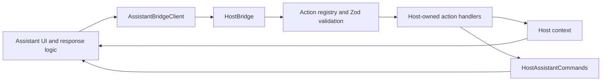

# @daino92/assistant-bridge

Start with the [React host quick start and responsibility cheat sheet](docs/quick-start.md) for a minimal integration with iframe or Module Federation.

React hosts can use `AssistantEmbed` from `/react` with a typed `config` selecting iframe or federation. The SDK chooses the adapter, defers federation loading until selected and remounts connections when `attempt` changes. Hosts retain URLs, panel visuals and build configuration. See [unified embedding](docs/react.md#unified-assistant-embedding).

A framework-agnostic integration layer between a host application and an assistant. The host defines which actions the assistant can request, publishes application context, and sends commands back to the assistant.

The root SDK entry contains no React or federation runtime imports. Optional adapters are isolated behind `/react`, `/federation` and `/ag-ui` subpath exports. The host owns its routes, state, UI, and action handlers; the chat owns conversations and message rendering; the BFF owns model calls and agent execution. This package supplies the communication contracts and execution boundary between them.

## Beta installation

Version `0.1.0-beta.1` is a prerelease. The public API may change before the first
stable release. After this version is published, install it with the `beta` tag:

```bash
pnpm add @daino92/assistant-bridge@beta 'zod@^4.6.0'
```

| Entry point         | Additional peer dependencies          |
| ------------------- | ------------------------------------- |
| Core                | None beyond Zod                       |
| `/react`            | `react@^19.3.0`                       |
| `/federation`       | `@module-federation/runtime@2.9.2`    |
| `/react/federation` | Both React and the federation runtime |
| `/ag-ui`            | None beyond Zod                       |

React applications also supply their renderer, such as React DOM. This package
does not include an assistant UI or backend.

## Minimal core example

```ts
import { createHostIntegration } from '@daino92/assistant-bridge';

const integration = createHostIntegration({
  appId: 'my-app',
  actions: [],
});

integration.updatePage({
  route: '/dashboard',
  page: { title: 'Dashboard', type: 'dashboard' },
});

// Give the assistant only integration.assistantClient.
// Register host actions explicitly before allowing assistant-driven changes.

// When the host integration is no longer needed:
integration.dispose();
```

For embedding and allowed actions, see the [React quick start](docs/quick-start.md).

## What it provides

| API                                            | Responsibility                                                                                      |
| ---------------------------------------------- | --------------------------------------------------------------------------------------------------- |
| `createHostIntegration`                        | Creates and connects the bridge, action registry, context manager, target registry, and client APIs |
| `AssistantBridgeClient`                        | Assistant-facing access to host context and action requests                                         |
| `HostAssistantCommands`                        | Host-facing commands: open, close, focus, prefill, and submit prompt                                |
| `HostActionRegistry`                           | Validates action payloads with Zod, checks availability, and executes registered handlers           |
| `HostContextManager`                           | Publishes route, page, selection, capabilities, and revision updates                                |
| `UiTargetRegistry`                             | Resolves host-owned targets for highlighting, scrolling, focusing, and selecting                    |
| `HostBridge`                                   | Coordinates requests, results, readiness, context events, and integration timeline entries          |
| `TypedEventBus` / `RequestResponseChannel`     | Typed in-memory events and correlated request/result handling                                       |
| `attachHostPort` / `createPortAssistantClient` | Adapt the bridge to a private `MessagePort`, used by the iframe integration                         |

The SDK does not provide a chat interface, model provider, backend, conversation storage, or host-specific business logic. Both real and simulated assistants can use the same client interface.

`attachAssistantCommandHandler` connects a same-window command receiver to the host bridge. `AssistantCommandHandler` and `EmbeddedAssistantOptions` define the framework-independent embedding contract.

## High-level integration APIs

Use the single package, `@daino92/assistant-bridge`. Its root entry stays framework agnostic. Optional subpath exports provide [React context and hooks](docs/react.md) (`@daino92/assistant-bridge/react`) and [Module Federation loading](docs/federation.md) (`@daino92/assistant-bridge/federation`). Neither adapter is imported by the core or the chat.

```ts
import { createHostIntegration } from '@daino92/assistant-bridge';
import { IntegrationProvider, useIntegration } from '@daino92/assistant-bridge/react';
import { connectFederatedAssistant } from '@daino92/assistant-bridge/federation';
```

`react` and `@module-federation/runtime` are optional peer dependencies: consumers supply React for `/react`, and the federation runtime for `/federation`. A React federation host uses both. Zod remains a required peer dependency. Optional peers do not mean all functions can be imported from the root; use the matching entry point. The SDK's development dependencies support building/testing all adapters inside this workspace.

Update the current page through one coordinated call:

```ts
integration.updatePage({
  route: pathname,
  page: { title: 'Catalog', type: 'catalog-list' },
  selection: 'clear',
});
```

This updates context, clears active highlights and refreshes capabilities. Selection defaults to `clear`; pass `preserve` for pages where the existing selection remains relevant. The host supplies that policy and its page metadata. Lower-level context APIs remain available for other updates.

For iframe embedding, create the URL with `createAssistantIframeUrl(url, window.location.origin)`, render it in the host's iframe and connect:

```ts
const disconnect = integration.connectIframe({
  iframe,
  url: assistantUrl,
  onStatus: (status) => console.log(status),
});
```

The SDK verifies the exact iframe origin and source, creates/transfers the private port, waits for acknowledgement, handles frame reload sessions and reports `loading`, `ready` or `error`. The default handshake timeout is 8 seconds; override it with `timeoutMs`. Call `disconnect()` when removing the frame or replacing the connection.

Inside the chat:

```ts
const disconnect = connectAssistantIframe({
  hostOrigin,
  onCommand,
  onClient,
  onContext,
});
```

`hostOrigin` must be the intended parent origin. The SDK checks parent source/origin and validates the initial context before exposing the client. The chat remains responsible for executing its commands and rendering context. Standalone windows do not connect.

For a directly supplied component or mount API, `connectEmbeddedAssistant(integration, { onStatus })` returns `bridge` and `onReady` properties, plus `dispose()` and `fail()`. Its default 10-second timeout covers both loading and receiver registration. Call `onReady(handler)` only once the command receiver is usable, and run the returned cleanup on unmount. Failed or disposed connections cannot become ready later. Reconnection creates a new connection.

Host command helpers preserve the existing command protocol:

```ts
await integration.assistantCommands.askAbout('Explain this item', { type: 'catalog', id });
await integration.assistantCommands.prefillAndOpen('Review current selection');
```

`askAbout` publishes an optional selection, opens the assistant, then submits the prompt with the current context revision. `prefillAndOpen` opens before prefilling.

## Communication flow



Assistant-to-host actions and host-to-assistant commands use protocol version `1.0.0` and UUID `requestId` values to correlate results. Context notifications do not automatically submit a prompt.

## Standalone development

```bash
pnpm install
pnpm build
pnpm typecheck
pnpm test
pnpm lint
```

This repository contains only the SDK, its tests and documentation. It does not
include the host SPA, assistant UI or BFF. Existing examples that refer to those
applications describe the original integration workspace.

The package name is `@daino92/assistant-bridge`. It is not published yet.
It is configured for public distribution on npmjs.org under the MIT license.
Publishing requires an explicit release step.

`pnpm build` emits JavaScript and declarations, rewrites internal aliases and
extensionless imports, and generates the protocol schemas. `pnpm pack` creates
a local installation archive without publishing to a registry.

## 1. Create the host integration

Create one integration for the lifetime of the host application. Register only the actions that application intends to expose.

```ts
import { createHostIntegration, navigateAction } from '@daino92/assistant-bridge';

const integration = createHostIntegration({
  appId: 'my-host',
  initialRoute: '/',
  initialPage: { title: 'Dashboard', type: 'dashboard' },
  actions: [
    navigateAction({
      navigate: (path) => window.history.pushState(null, '', path),
      allowedRoutes: ['/', '/catalog', '/records'],
    }),
  ],
  onTimeline: (entry) => console.debug(entry),
});
```

The navigation callback is illustrative. In a routed application, supply its router's navigation function so route rendering and context updates stay coordinated. This repo does that in HostIntegrationProvider (`../../src/app/providers/HostIntegrationProvider.tsx` in the original integration workspace).

The returned integration exposes `bridge`, `contextManager`, `actionRegistry`, `targetRegistry`, `assistantCommands`, and `assistantClient`. Keep those host services on the host side; give assistant application logic only `AssistantBridgeClient`.

## 2. Define host-owned actions

Use `defineAction` for application-specific behavior. Its Zod schema validates incoming payloads before the handler runs; `available` can restrict execution to an appropriate host context.

```ts
import { defineAction, recordsFilterPayloadSchema } from '@daino92/assistant-bridge';

// Include this action in createHostIntegration({ actions: [...] }).
// applyFilters is supplied by the host and updates its own state.
const createRecordsFilterAction = (
  applyFilters: (filters: {
    search?: string;
    status?: 'active' | 'pending' | 'archived' | 'all';
  }) => void,
) =>
  defineAction({
    name: 'records.filter',
    description: 'Filter the host records table',
    schema: recordsFilterPayloadSchema,
    available: (context) => context.route.startsWith('/records'),
    handler: (payload) => {
      applyFilters(payload);
      return { applied: payload };
    },
  });
```

An action name or exported schema does not register a handler automatically. The host must supply the action explicitly. See the host action list (`../../src/host/actions.ts` in the original integration workspace) for navigation, catalog filtering, records filtering, and sorting examples.

Built-in action factories are `navigateAction`, `highlightAction`, `scrollToAction`, `focusAction`, `selectAction`, and `openDetailsAction`. UI-target actions operate on targets registered by the host. The action factory callback provides the shared registry:

```ts
import { createHostIntegration, focusAction, highlightAction } from '@daino92/assistant-bridge';

const integration = createHostIntegration({
  appId: 'my-host',
  actions: ({ targets }) => [highlightAction(targets), focusAction(targets)],
});
```

Register and unregister UI targets as their elements mount and unmount. This repo's useUiTarget (`../../src/hooks/useUiTarget.ts` in the original integration workspace) demonstrates the React adapter; React is not part of the SDK.

## 3. Publish context from the host

```ts
integration.contextManager.setRoute('/catalog', {
  title: 'Catalog',
  type: 'catalog-list',
});

// Updates selection and also emits host.entity.selected.
integration.bridge.publishEntitySelected('catalog', 'product-001');

integration.contextManager.clearSelection();
```

Context includes `appId`, `route`, `page`, optional `selection`, registered `capabilities`, and an incrementing `revision`. Publish route and selection changes from the host; the SDK does not observe the router or DOM itself.

If actions are registered or removed after initialization, call `integration.bridge.syncCapabilities()` to refresh the published capabilities. The capability list describes registered actions; context-specific `available` checks still run during execution.

## 4. Use the client inside the assistant

```ts
import type { AssistantBridgeClient, HostContext } from '@daino92/assistant-bridge';

const connectAssistant = (
  client: AssistantBridgeClient,
  renderContext: (context: HostContext) => void,
) => {
  renderContext(client.getInitialContext());
  const unsubscribe = client.subscribeContext(renderContext);

  const openCatalog = async () => {
    const context = client.getInitialContext();
    return client.requestHostAction('ui.navigate', { path: '/catalog' }, context.revision);
  };

  return { openCatalog, dispose: unsubscribe };
};
```

Despite its name, `getInitialContext()` returns the latest available snapshot. `subscribeContext()` receives subsequent changes and returns an unsubscribe function. An action request resolves to the handler's returned data or rejects on failure.

The optional revision is a **minimum host revision**, not an exact-match check. The registry rejects a request when the host revision is lower than the supplied revision; a newer host context is accepted.

## 5. Send commands from the host

Once a receiver is attached and ready:

```ts
await integration.assistantCommands.open();
await integration.assistantCommands.focus();
await integration.assistantCommands.prefill('Review the selected item');
await integration.assistantCommands.submitPrompt('Show active records', {
  source: 'records-page',
});
await integration.assistantCommands.close();
```

The receiver must implement these commands and return correlated results. The SDK does not create or open a panel itself. `submitPrompt()` completion means the receiver returned a command result; it does not inherently mean response streaming has finished. The current chat acknowledges the prompt before streaming its simulated response.

For a same-window receiver, use `attachAssistantCommandHandler(integration.bridge, handler)`. It validates command envelopes and emits correlated results from the handler's return value or rejection. The handler must validate command-specific payloads and reject unsupported commands. The returned function detaches the receiver; the host also calls `notifyAssistantUnmounted()` when disconnecting.

For an iframe receiver, the port adapter forwards command requests to the `onCommand` callback passed to `createPortAssistantClient` and creates the result envelope from its return value or rejection.

## Same-window embedding versus an iframe

| Deployment                                                                            | Connection                                                                      |
| ------------------------------------------------------------------------------------- | ------------------------------------------------------------------------------- |
| Component, mounted module, or Module Federation remote in the same JavaScript context | Pass `integration.assistantClient` directly; no port transport is needed        |
| Chat inside an iframe or a separate browser window                                    | Establish a cross-window connection; this repo uses a transferred `MessagePort` |

Keeping the chat in a separate workspace project does not require an iframe. The iframe adds runtime and styling isolation; the client interface stays the same in either approach.

For a same-window integration, attach the command handler before announcing readiness with `integration.bridge.notifyAssistantReady('my-assistant')`.

The chat now exposes a working Module Federation remote, assistant_chat/EmbeddedAssistant. It accepts EmbeddedAssistantOptions: a bridge client and an onReady(handler) callback that returns cleanup. The SDK connection adapter registers the command handler and marks the assistant ready; the chat invokes cleanup on unmount. No MessagePort is used in this mode. See integration modes and examples (`../../apps/assistant-chat/INTEGRATION.md` in the original integration workspace).

For the iframe integration:

Both applications import `ASSISTANT_IFRAME_MESSAGES` from the SDK for the brand-neutral readiness, connection, and acknowledgement handshake names. Assistant instance IDs describe the adapter (`assistant-iframe` or `assistant-federation`); host application identity remains supplied through `appId`.

1. The chat announces readiness to its configured host origin.
2. The host checks the message's exact `origin` and `source` against the intended iframe.
3. The host creates a `MessageChannel`, calls `attachHostPort(port1, integration.bridge)`, and transfers `port2` with a context snapshot to the verified iframe origin.
4. The chat verifies the parent origin/source, validates the context, and calls `createPortAssistantClient(port2, context, onCommand)`.
5. After the chat acknowledges the connection, the host marks the assistant ready. Application logic uses the returned `client` as `AssistantBridgeClient`.

The port adapters validate envelopes, correlate requests, forward context and commands, enforce a fixed 10-second port request timeout, and reject pending requests when disposed. The port layer currently converts remote failures into `Error` messages; structured error codes are not preserved end-to-end through that adapter.

The high-level iframe connection APIs own the window handshake and exact origin/source checks. The host owns iframe rendering, visibility and the reconnect button. Low-level `attachHostPort` remains available, but callers using it directly must perform their own window checks. See the working implementations:

- Host: AssistantPanel (`../../src/components/AssistantPanel.tsx` in the original integration workspace)
- Chat connection hooks: [assistant-side React hooks](docs/react.md#assistant-side-hooks); chat composition: useChatApp (`../../apps/assistant-chat/src/hooks/useChatApp.ts` in the original integration workspace)
- Command handling and action requests: useChatController (`../../apps/assistant-chat/src/hooks/useChatController.ts` in the original integration workspace)

## Lifecycle, errors, and cleanup

### Structured diagnostics through the timeline

Use the existing `onTimeline` callback; no separate logger or logging service is installed:

```ts
onTimeline: (entry) => {
  if (entry.diagnostic) {
    const { code, phase, mode, message, errorCode } = entry.diagnostic;
    // Forward these fields and entry.requestId to your own logger or UI.
  }
};
```

`IntegrationDiagnostic` is exported from the root SDK. Diagnostic entries use the existing timeline event channel and have `result.success: false`. The SDK does not automatically write to the console or send telemetry. `CONNECTION_FAILED` describes an explicitly failed generic connection. All current diagnostics describe failures; intentional disposal emits no failure diagnostic. Connection timeouts/failures are emitted once per failed connection; late completion cannot reactivate it.

| Codes                                                                                   | Phase                             |
| --------------------------------------------------------------------------------------- | --------------------------------- |
| `IFRAME_HANDSHAKE_TIMEOUT`, `IFRAME_HANDSHAKE_FAILED`                                   | `handshake`                       |
| `FEDERATION_ADAPTER_TIMEOUT`, `FEDERATION_ADAPTER_LOAD_FAILED`                          | `adapter-load`                    |
| `FEDERATION_RUNTIME_UNAVAILABLE`, `FEDERATION_LOAD_FAILED`, `FEDERATION_EXPORT_MISSING` | `remote-load`                     |
| `FEDERATION_RENDER_FAILED`                                                              | `render`                          |
| `CONNECTION_TIMEOUT`                                                                    | `remote-load` or `receiver-ready` |
| `ACTION_FAILED`, `COMMAND_FAILED`                                                       | `action` or `command`             |

Connection diagnostics include `mode` (`iframe`, `federation` or `embedded`). Action/command diagnostics include the correlated timeline `requestId` and protocol `errorCode` when available. They omit mode because the core request can originate outside an embedding adapter. Failed remote loading is reported generically when the runtime cannot distinguish a network failure from an exposure-resolution failure; raw exception text is not copied into diagnostics.

Request payload summaries now read `Payload omitted`. Failure summaries use generic messages, and diagnostics omit raw prompts, payloads, remote URLs and exception text. Existing context/selection timeline entries still contain host-provided routes and entity identifiers; the timeline is not a universal data redactor. The host owns log retention, filtering and destinations. Protocol errors returned to callers retain their existing behavior.

Consumers can forward structured diagnostics from `onTimeline` to their own UI or logging service. The host keeps a simple connection error UI; it does not persist a timeline by default.

- High-level connection APIs manage readiness, availability, receiver cleanup and connection timeouts. Dispose them when removing the assistant. The following low-level operations remain available for custom adapters.
- Call `bridge.notifyAssistantReady(id)` only after the command receiver is usable.
- Call `bridge.setAssistantAvailable(false)` for temporary unavailability; pending host commands are rejected.
- Call `bridge.notifyAssistantUnmounted()` when removing the receiver.
- Unsubscribe context/event listeners and dispose both port adapters when disconnecting.
- Call `integration.dispose()` when the host integration is permanently disposed. It owns SDK cleanup; host components still own their DOM and rendering lifecycle.

Host bridge action and command timeouts default to 10 seconds and can be configured using `actionTimeoutMs` and `commandTimeoutMs` in `createHostIntegration`. These options do not change the port adapter's separate fixed timeout. Timing out a request does not cancel or roll back an action handler that has already started.

Common host-side failures include `UNKNOWN_ACTION`, `INVALID_PAYLOAD`, `ACTION_NOT_AVAILABLE`, `STALE_CONTEXT`, `RECEIVER_UNAVAILABLE`, `TIMEOUT`, and `EXECUTION_FAILED`. Use `onTimeline` to inspect request IDs, directions, results, and durations. Treat payload summaries as application data when deciding where to store logs.

`requiresConfirmation` is enforced by the registry: protected calls without a separate `confirmed` flag return `CONFIRMATION_REQUIRED`. The chat adapter must collect explicit approval before forwarding that flag. Application authentication and server authorization remain host/backend responsibilities. Published capability schemas are a simplified description; the registered Zod schema is the runtime validator.

## Commands

Run from the repository root:

```sh
pnpm build          # Compile the SDK, declarations and schemas
pnpm typecheck      # Check SDK source and tests
pnpm test           # Run SDK unit tests
pnpm lint           # Check coding conventions
pnpm format:check   # Check formatting
```

The `/react` entry also provides `useUiTarget` for DOM target registration and `useAssistantPanel` for panel visibility, command subscriptions, connection status and reconnect attempts. Hosts retain their styling, availability controls and transport components. See [React integration examples](docs/react.md).

React hosts can render `AssistantIframe` from `/react` or `FederatedAssistant` from `/react/federation` instead of writing local embedding wrappers. These components own connection lifecycle and the federation render error boundary; hosts supply configuration and visuals. The `/react/federation` export is isolated from `/react` to avoid loading the federation runtime for iframe-only React consumers. See [ready-made React components](docs/react.md#ready-made-iframe-component).

Assistant UIs can use `/react` hooks `useAssistantIframeConnection`, `useAssistantContext` and `useAssistantCommandHandler` to handle iframe initialization, scoped context subscriptions and same-window command registration. These assistant-side hooks do not require a host `IntegrationProvider`. Chat command implementations and UI state remain application-owned.

React hosts can create their stable instance with `useHostIntegration` from `/react`. It manages committed action updates, current timeline callbacks and final bridge/highlight cleanup, including Strict Mode effect replay. Bootstrap identity/timeouts stay fixed until remount; routes and selection policy remain host-owned through `updatePage`. See [managed host integration](docs/react.md#managed-host-integration).

## Compose common UI actions

```ts
import { createUiActions, defineAction } from '@daino92/assistant-bridge';

const actions = [
  ...createUiActions({
    navigation: { navigate, allowedRoutes: ALLOWED_ROUTES, detailPattern: DETAIL_ROUTE },
    targets: { registry: targets, enable: ['highlight', 'scrollTo', 'focus', 'select'] },
    details: { open: openDetails },
  }),
  // Add host-specific actions with defineAction(...).
];
```

`createUiActions` returns `HostActionInput[]` without registering or executing anything. Pass the result to `createHostIntegration` or `useHostIntegration`. Omitted groups enable no actions; `{}` returns an empty list. Target action names are explicitly selected and duplicate selections are included once, in their first-occurrence order. Navigation is emitted first, then selected target actions, then details.

`CreateUiActionsOptions` and `UiTargetActionName` are exported for typed configuration. The helper delegates to the existing individual action factories, preserving their schemas, route checks and errors. Those factories remain available separately. Hosts still own allowed routes, detail URL mapping, target IDs and business handlers; the helper adds no catalog/records store access or implicit permissions.

## AG-UI agent client

The optional `@daino92/assistant-bridge/ag-ui` entry exports `WebSocketAgent` (extends the official `@ag-ui/client` AbstractAgent), the existing `runWebSocketAgent` facade, `createHostAgentOptions` and official AG-UI types/schemas. It connects the independent chat to an agent BFF; it is separate from the iframe/federation bridge connecting the chat to the host.

`createHostAgentOptions(bridge)` advertises the current non-confirmation host tools and page/selection context, and delegates approved tool calls back through `requestHostAction`. The client validates run/message/tool correlation, preserves text deltas exactly, forwards tool results and disposes the socket on completion, error, cancellation or timeout. The SDK root remains free of agent/provider imports.

See the wire contract (`../../apps/assistant-chat/WEBSOCKET.md` in the original integration workspace) and Node BFF setup (`../../apps/assistant-bff/README.md` in the original integration workspace). The POC currently uses raw WebSocket; STOMP is deferred. Provider credentials and model selection (OpenAI or LiteLLM/Gemma) belong only to the BFF.

The official client owns event-order verification, message assembly and AG-UI state reduction. `websocket-agent.ts` only binds the existing BFF control envelopes to an Observable; `run-websocket-agent.ts` adapts client subscribers to the chat callbacks and forwards host tool results; `host-tools.ts` owns capability mapping and permission checks. The existing `runWebSocketAgent({ url, input, signal, onText, executeTool })` call is unchanged, so chat and BFF contracts remain compatible.

Raw `WebSocketAgent` consumers can use `runAgent`, subscribers, `messages` and `state` directly; a fresh instance is created per run by the compatibility facade. Host tool execution is performed by that facade, not automatically by a raw client. Safety limits, strict final tool-argument parsing, current permissions and error propagation remain application-owned. The direct RxJS version is pinned to the official client's version to share its Observable types. See [AbstractAgent](https://docs.ag-ui.com/sdk/js/client/abstract-agent).

### Discoverable host targets and refreshed tools

Hosts can pass `destinations: [{ path: '/records', label: 'Records' }]` to `createHostIntegration` / `useHostIntegration`. Register readable target metadata with `useUiTarget('dashboard.kpi.revenue', { label: 'Revenue pipeline', description: 'Projected revenue' })`. The SDK publishes mounted target IDs, descriptions and supported interactions in `HostContext.targets`; DOM nodes and callbacks stay in the host. Capability publication respects each action's `available` predicate for the current context.

`createHostAgentOptions(bridge, { signal })` returns `tools`, `context`, `executeTool` and `getHostState`. Put `tools` and `context` in `input`, and pass `executeTool` and `getHostState` as callbacks to `runWebSocketAgent`. Successful navigation waits for the destination context with a bounded timeout; tool results carry fresh tools/context to the BFF for the next turn. The SDK rechecks current permissions on every execution and updates its run allowlist before returning the result. See the WebSocket binding (`../../apps/assistant-chat/WEBSOCKET.md` in the original integration workspace).

`runWebSocketAgent` also accepts `onToolActivity({ id, name, status, args, error })`. Status is `running`, `succeeded` or `failed`, based on the actual host callback result. Chat UIs can retain an action timeline independently of generated prose. Arguments are provided for presentation mapping; this POC stores only a derived label and outcome. Host error details are mapped to safe user messages. `onActivity` remains available for existing consumers.

### Protected agent tools

`createHostAgentOptions(bridge, { signal, requestConfirmation })` optionally exposes capabilities marked `requiresConfirmation`. The callback receives `{ name, description, args }` and returns `Promise<boolean>`. Without a callback, protected capabilities are excluded. The adapter snapshots arguments, checks cancellation and rechecks current route/capability after approval before dispatch. Rejection returns an `ACTION_REJECTED` tool error and a `rejected` activity outcome.

The trusted chat adapter forwards a separate `confirmed` flag through `requestHostAction`; the host action registry rejects protected calls without it. This is a UI consent contract between trusted clients, not authentication or a signed approval. Business HTTP endpoints and authorization remain application-owned. Stop/close/deadline must abort the signal and dismiss pending approval; already executed actions are not rolled back.

Business entities are separate from UI targets in `HostContext.entities`: each has a type, canonical ID, label, optional reference/aliases and string attributes. The host publishes route-relevant cached entities through `contextManager.setEntities`. Only host-selected summary fields cross the bridge; no full business objects are inferred from target IDs. The agent receives these summaries to resolve names to canonical IDs.

Protected action confirmation receives a copy of the current entity summaries. The chat uses those host-supplied labels and status values to show the item name and before/after status without technical tool descriptions or JSON for status changes and deletion. If the route, capabilities or entity summaries change while approval is pending, dispatch is rejected; a new action request is required. Entity metadata is context, not authorization, and host handlers remain authoritative.

Host handler errors may carry known protocol codes such as `RESOURCE_NOT_FOUND`, `SERVICE_UNAVAILABLE`, `INVALID_PAYLOAD` or `STALE_CONTEXT`. The registry preserves known codes through both embedding transports and falls back to `EXECUTION_FAILED` for unknown codes. The AG-UI adapter maps them to safe actionable messages rather than displaying arbitrary server details. A changed entity snapshot during approval returns `STALE_CONTEXT`.

### STOMP over WebSocket

Pass `transport: 'stomp'` to `runWebSocketAgent`/`WebSocketAgent` and use the BFF STOMP URL (`ws://localhost:3001/agent/stomp`). Omit transport or pass `'websocket'` for the original binding. Event validation, tool handling, approval callbacks and cancellation stay shared. STOMP.js is dynamically loaded for a STOMP run; it is not exported through the SDK root. See configuration and wire contract (`../../apps/assistant-chat/STOMP.md` in the original integration workspace). This adapter uses the documented fixed destinations; connecting to another STOMP backend requires that backend to implement the same binding.

See the [language-independent AG-UI transport contract and JSON fixtures](docs/ag-ui-protocol.md) for implementing a compatible BFF. Shared control schemas/types are exported from `/ag-ui`; no server SDK is required.

### Protocol-independent action executor

Any trusted chat can use the core SDK action executor without importing AG-UI, React, STOMP or a model SDK:

```ts
import { createAssistantActionExecutor } from '@daino92/assistant-bridge';

const { executeAction } = createAssistantActionExecutor(bridge, {
  signal: controller.signal,
  requestConfirmation: async ({ name, description, args, entities }) => {
    return showConfirmation({ name, description, args, entities });
  },
});

await executeAction('records.updateStatus', {
  recordId: 'record-012',
  status: 'pending',
});
```

The executor snapshots arguments, checks current capabilities, requests approval for protected actions, rechecks route/entities after approval, forwards the confirmed flag and waits for host context readiness. Without a confirmation callback protected calls fail without dispatch. Rejection preserves `ACTION_REJECTED`; changed entity context yields `STALE_CONTEXT`. Confirmation rendering remains chat-owned. The SDK confirmation controller handles dismissal on cancellation; custom confirmation callbacks must provide their own cancellation handling. Cancellation prevents later dispatch after approval but cannot undo an already executed mutation. Existing navigation/detail readiness rules and bounded context wait are unchanged.

`ActionConfirmation` and `AssistantActionExecutorOptions` are exported from the core SDK. The `/ag-ui` entry continues to re-export `ActionConfirmation` for compatibility. `createHostAgentOptions` delegates action execution to this executor and retains only AG-UI tool/context mapping; existing consumers need no changes. This trusted-client consent boundary does not replace server-side authorization.

### Action readiness

`createAssistantActionExecutor` and `createHostAgentOptions` accept the same optional readiness configuration:

```ts
const executor = createAssistantActionExecutor(bridge, {
  signal: controller.signal,
  contextWait: { timeoutMs: 5000, settleMs: 50 },
  readiness: {
    'custom.open': ({ context, previousContext, args, result }) => {
      return (
        context.route === '/custom' &&
        context.targets?.some((target) => target.id === 'custom.loaded') === true
      );
    },
  },
});
```

Predicates receive the latest context, the pre-dispatch context, snapshotted arguments and the action result. They run after a successful dispatch, immediately against the current snapshot and again on context notifications. Returning true starts a quiet window; every notification resets that window. Timeout defaults to 3000 ms, quiet window to 50 ms. Cancellation, timeout and predicate/subscription errors clean up timers/listeners. A readiness failure does not roll back a completed action and must not trigger automatic mutation retries.

`defaultActionReadiness` provides rules for `ui.navigate` (exact requested route) and `ui.openDetails` (route ending in the requested entity ID); override either for custom route formats or additional target requirements. Other actions wait only for the quiet context window. Default navigation rules do not prove that asynchronous data or all UI targets have loaded: supply an explicit predicate when subsequent actions depend on those. Predicates must be synchronous, side-effect free and inspect published context; they cannot query server state asynchronously.

`waitForHostContext(bridge, predicate, { signal, timeoutMs, settleMs })` is also exported for direct use. Configuration is supplied where the executor runs, normally in the independent chat application. Functions are not serialized across the iframe/AG-UI protocol. The host publishes the route, targets and entity summaries used by those predicates; backend implementation is unchanged.

### Action schemas: one source of truth

Actions keep their Zod `parametersSchema` for TypeScript inference and host-side `safeParse` validation. Advertised capabilities use Zod 4 `z.toJSONSchema(schema, { io: 'input', target: 'draft-7' })`, preserving enum values, required/optional fields, nested objects/arrays, descriptions and representable constraints for the model. The input representation describes what callers send; Zod still applies defaults and transforms when executing the action. Unknown fields follow the input schema's policy (ordinary Zod objects accept and strip them).

No separate hand-maintained JSON Schema is required. Custom types that Zod cannot express as JSON Schema cause capability generation to throw instead of silently advertising a misleading generic schema. Custom refinements and other runtime-only checks are not guaranteed to appear in JSON Schema; the host's Zod validation remains authoritative. This does not change action availability, confirmation requirements or execution permissions.

### Shared integration errors

`normalizeIntegrationError(error)` returns only `{ code, message }`: recognized SDK codes are preserved and messages come from a shared safe catalog. Unknown codes, untyped exceptions, string rejections and misleading code names embedded in message text fall back to `EXECUTION_FAILED`. Raw handler messages, stacks and extra fields are not forwarded. `createIntegrationError(ERROR_CODES.TIMEOUT)` creates a standard `Error` carrying the same safe code/message; `isIntegrationErrorCode(value)` checks supported codes.

Registry execution, same-window command handlers, request/result channels, iframe transport and AG-UI host tool outcomes use this policy. SDK readiness waits emit `TIMEOUT`; unavailable actions and missing UI targets have explicit codes. `ACTION_REJECTED` is now an SDK error code, used for user rejection. The AG-UI adapter checks codes instead of guessing categories from arbitrary message text. Provider/run errors remain a separate BFF concern; this API normalizes integration failures, not arbitrary provider-specific codes.

Host handlers should throw an error/object with a supported `code`. Handler messages are no longer part of the public error contract. Inspect `code` for branching and translate it in application UI if needed. Unknown custom codes are intentionally not transported unchanged. Approval, execution and cancellation behavior are otherwise unchanged.

### Dispose the host integration

```ts
const integration = createHostIntegration({ appId: 'host', actions });

// When the host integration permanently ends:
integration.dispose();
```

`dispose()` is synchronous and idempotent. It closes SDK-managed iframe/embedded/federation connections, cancels their loading timers, rejects pending action/command requests with `RECEIVER_UNAVAILABLE`, clears active highlights and timers, and releases target/context subscriptions and registered action handlers. The instance is terminal: do not reuse it; create a new integration to reconnect. Calls to `updatePage` or new connection setup after disposal fail; later action/command requests reject immediately without new timers.

`useHostIntegration` calls `dispose()` automatically on final unmount while preserving Strict Mode replay behavior. `IntegrationProvider` only shares the instance and does not dispose an externally supplied integration. Component-level connection cleanup remains safe to call before or after the integration is disposed.

`HostBridge.signal` and optional `AssistantBridgeClient.signal` indicate SDK lifetime termination. Built-in clients provide the signal; custom clients can omit it for compatibility. Readiness waits listen to both caller cancellation and client lifetime. The iframe port sends an internal `disconnect` notification so the chat-side client can reject pending requests and abort its lifetime signal. This is part of the host/chat bridge, not a change to the BFF AG-UI transport contract.

Disposal does not remove host DOM, unload federation runtime caches, cancel arbitrary already-running handler promises, roll back completed mutations or stop independently owned BFF/model runs. Confirmation UI and per-run cancellation remain owned by the chat application. The SDK prevents later dispatch after an awaited confirmation if its client lifetime ended.

### Headless action confirmations

`createActionConfirmationController()` from the core SDK owns one pending approval, its promise, abort listener and subscribers. It is independent of React and AG-UI. The executor passes its combined run/client lifetime signal as the optional second argument to `requestConfirmation`; existing one-argument callbacks still work.

```ts
const confirmations = createActionConfirmationController();
const executor = createAssistantActionExecutor(bridge, {
  signal: runController.signal,
  requestConfirmation: confirmations.requestConfirmation,
});

const unsubscribe = confirmations.subscribe(() => {
  renderConfirmation(confirmations.getSnapshot());
});

// UI decisions must reference the displayed confirmation ID:
confirmations.approve(displayedConfirmation.id);
// or confirmations.reject(displayedConfirmation.id);

// On permanent owner teardown:
unsubscribe();
confirmations.dispose();
```

The snapshot is a `PendingActionConfirmation` (`ActionConfirmation` plus an opaque `id`). Requests are cloned; only one may be pending. Approve resolves true, Reject resolves false, and cancellation rejects. Decisions for old IDs do not approve a newer request. `cancel()` cancels the current request but permits later requests; `dispose()` is terminal and idempotent. Stop/client disconnect/integration disposal automatically cancel a pending confirmation when connected through the executor signal. Controller disposal clears subscribers and prevents future requests.

React consumers use `useActionConfirmation()` from `/react`. It exposes `{ confirmation, requestConfirmation, approve, reject }`; handlers already bind the visible ID. It uses the core controller and disposes on final unmount while remaining safe under Strict Mode effect replay. The chat owns its confirmation card, labels and business-specific presentation. Context is still rechecked after approval by the executor; this change does not introduce automatic dismissal on context updates, a queue, or server authorization.

### Shared host action lifecycle

Every action executed through `createAssistantActionExecutor` has a unique `actionExecutionId`, a monotonic per-execution `sequence` and events:

```text
requested -> awaiting-approval (when required) -> running -> succeeded / failed
                       -> rejected / cancelled
requested -> failed / cancelled
running -> cancelled
```

Subscribe on the host without depending on React or AG-UI:

```ts
const unsubscribe = integration.subscribeActionLifecycle((event) => {
  // event.actionExecutionId, action, status, timestamp, sequence, dispatched, error?
  updateHostFeedback(event);
});
```

A generic chat can pass `onActionLifecycle` to `createAssistantActionExecutor`; an AG-UI chat passes it to `runWebSocketAgent` together with `executeTool` from `createHostAgentOptions`:

```ts
const host = createHostAgentOptions(bridge, { signal, requestConfirmation });

await runWebSocketAgent({
  ...runOptions,
  input: { ...runOptions.input, tools: host.tools, context: host.context },
  executeTool: host.executeTool,
  getHostState: host.getHostState,
  onActionLifecycle: (event, details) => {
    updateChatProgress(event, details?.args);
  },
});
```

Events are generated once by the executor and forwarded through the direct/iframe bridge to the host. `AssistantBridgeClient.publishActionLifecycle` and `subscribeActionLifecycle` are optional for compatibility with custom clients; built-in clients implement both. Legacy custom clients still get executor-local callbacks but cannot forward them without implementing these methods. Unsubscribe when your observer ends; `integration.dispose()` clears host observers.

The AG-UI adapter supplies optional execution metadata as the third `executeTool(name, args, execution)` argument: an execution ID, `toolCallId` and lifecycle listener. The SDK executor handles it. Existing custom execute functions may ignore it; they keep legacy `onToolActivity` behavior but must delegate/implement that metadata callback to produce the new lifecycle. The AG-UI adapter does not generate a second competing lifecycle. Existing callers may keep `onToolActivity`; the POC chat now consumes `onActionLifecycle`.

Confirmation requests include the same optional execution ID. Dispatch envelopes and integration timeline entries carry that ID, correlating approval, bridge request/result diagnostics and AG-UI tool calls. `succeeded` means host dispatch and configured context readiness completed. Rejection/failed validation before dispatch never invokes the handler. Abort produces one `cancelled` terminal event even when a legacy confirmation callback ignores the signal; late promise completion does not turn it into success.

`dispatched: true` conservatively means the execution entered its dispatch phase. Cancellation at/after that point does not prove the business operation stopped, failed, or rolled back; inspect current data before retrying a mutation. A failure may also come from post-dispatch readiness. These events are trusted-client telemetry, not authorization, exactly-once business delivery or proof of a database write. No automatic retries are added.

Wire events contain no arguments or return values. Errors use the shared safe catalog. Local listener `details.args` is a separate cloned presentation snapshot, never forwarded or added to diagnostics. Observer exceptions do not change action outcomes. The host validates event shape, sequence and transitions, ignores duplicate/terminal updates, and retains at most 256 execution states for telemetry validation. This bounded history is cleared on disposal; disconnected hosts or states evicted from that window may miss later telemetry. Do not use this stream as an audit database.

The BFF AG-UI/WebSocket/STOMP contract is unchanged: this lifecycle belongs to the host/chat bridge. Visual labels, toasts, history persistence and business decisions remain application-owned.

### Atomic host context

`integration.updatePage({ route, page, selection, entities })` applies a page change, optional selection clearing, entity summaries and derived action availability in one context commit. Context subscribers see at most one revision for that update, with capabilities computed against the new page/entities. Target registrations and later data changes remain separate updates.

The core `HostContextManager` now owns value equality and revision generation for all consumers. Repeating equivalent setter/update values does not notify subscribers or increment `revision`; object property order and omitted/undefined optional fields are equivalent for JSON context data. Revisions count effective published changes, not method calls.

Inputs, snapshots and each subscriber notification are deeply cloned, including page, selection, destinations, targets, entities and nested capability schemas. Mutating a returned snapshot or an input after assignment cannot alter stored state or another subscriber's notification. Reentrant updates are queued so subscribers observe revisions in order.

Repeated identical `updatePage` calls preserve current selection/highlights. Selection policy applies when route, page metadata or policy changes. Use `contextManager.clearSelection()` for an explicit same-page selection reset. Core `updatePage` preserves entities when omitted; the React `useHostPageContext` hook supplies an empty array by default to clear old page summaries. Hosts still own routing policy, entity mapping and action availability rules.

### Headless chat run controller

`createChatRunController` lives only in `/ag-ui`, independently of React and message storage:

```ts
import { createChatRunController } from '@daino92/assistant-bridge/ag-ui';

const runs = createChatRunController({
  url: 'ws://localhost:3001/agent',
  // transport defaults to 'websocket'; set 'stomp' for the corresponding endpoint
});

const unsubscribe = runs.subscribe(() => {
  renderRunState(runs.getSnapshot());
});

const result = await runs.start({
  threadId: conversationId,
  messages: preparedHistory,
  bridge, // optional for standalone chat
  requestConfirmation, // optional SDK controller or custom UI callback
  onText: updateMessageText,
  onActionLifecycle: updateActionProgress,
});

// result.status is completed, stopped, or failed (with error).
// runs.stop() cancels an active run; a subsequent start gets a fresh runId.
// Permanent owner teardown:
unsubscribe();
runs.dispose();
```

One run may be active per controller. `start()` throws synchronously for overlapping calls or after disposal; otherwise its promise resolves with a typed final outcome. The controller generates `runId`, preserves caller-owned `threadId`, snapshots outgoing messages/state, prepares current host tools/context and confirmation callbacks, and owns the run AbortController. Optional caller and host-client lifetime signals are combined; an already-aborted signal does not open a connection. Configuration URL/transport/timeout is fixed for the controller lifetime; the bridge and callbacks are supplied fresh per start.

`getSnapshot()` has a stable frozen top-level snapshot until the state changes (`idle`, `running`, or the last final outcome). It is compatible with `useSyncExternalStore`. `stop()` is reusable and safe in React effect cleanup/Strict Mode replay; permanent `dispose()` is idempotent and refuses future starts. Disposing removes state observers and aborts current work. The POC chat uses stop on unmount, leaving the now-unobserved, inactive controller eligible for garbage collection.

Text/activity callbacks from an aborted or previous run are ignored. A pending current action may still report its `cancelled` lifecycle during final cleanup, preserving post-dispatch uncertainty; callbacks after finalization or after a newer run starts are ignored. Failure/terminal completion also aborts pending host work before returning. A cleanup abort does not reclassify a provider failure as a user stop. Cancellation cannot roll back a host mutation or force an arbitrary custom handler promise to terminate.

The consuming chat still owns input/focus, history persistence, history-to-AG-UI message mapping, message IDs/records, retry policy, labels and presentation of outcomes. The controller neither imports Zustand nor creates a UI. It uses the existing `runWebSocketAgent`; no BFF protocol changes are required.

### Reusable progress reducer and command dispatcher

The core SDK exports `reduceActionProgress`, `finalizeActionProgress` and `ActionProgressEntry`. Consumers keep their own labels and storage:

```ts
const actions = reduceActionProgress(previousActions, event, {
  label: describeAction(event.action),
});
const finalActions = finalizeActionProgress(actions, 'stopped'); // or failed
```

The reducer upserts by `actionExecutionId`, preserves list order, ignores duplicate/older sequences and never resurrects terminal entries. Canonical ID/status/sequence/dispatch/error fields come from the lifecycle event; presentation fields remain consumer-owned. Inputs are not mutated; ignored updates return the original array. Finalization changes only unfinished entries, preserving completed/rejected/cancelled outcomes and the dispatch uncertainty flag. The legacy `stopped` status remains supported for saved chat histories.

`createAssistantCommandDispatcher` validates the standard command envelope and prefill/submit payloads, then invokes supplied callbacks:

```ts
const onCommand = createAssistantCommandDispatcher({
  onOpen: () => ({ opened: true }),
  onClose: closeConversation,
  onFocus: focusInput,
  onPrefill: (text) => {
    setInput(text);
    focusInput();
  },
  onSubmit: (prompt, metadata) => submitPrompt(prompt, metadata),
});
```

Callbacks may return synchronously or asynchronously. Explicit callback results are preserved; null/undefined results receive the normal opened/closed/focused/prefilled/acknowledged response. Unsupported commands or missing callbacks fail with `UNKNOWN_COMMAND`; malformed envelopes/payloads fail with `INVALID_PAYLOAD` before any callback runs. Callback failures propagate to the existing command error boundary for normalization. The helper does not own focus, visibility, input, history or run state; it does not automatically focus after prefill. Consumers choose those behaviors in callbacks. Submit metadata is forwarded separately and must not be treated as a retry message ID.

### Typed run errors

The optional `/ag-ui` entry exports `RUN_ERROR_CODES`, `RunError`, `RunErrorCode`, `createRunError`, `normalizeRunError`, `isRunErrorCode` and `describeRunError`. These describe whole-run failures, separately from core host action/command errors.

`ChatRunResult` with `status: 'failed'` now carries a safe `{ code, message }` rather than an arbitrary exception. Transport errors distinguish `CONNECTION_FAILED`, `CONNECTION_CLOSED`, `TIMEOUT`, `PROTOCOL_ERROR` and `RESPONSE_TOO_LARGE`. Server/provider codes include `INVALID_REQUEST`, `CONFIGURATION_ERROR`, `PROVIDER_AUTH_ERROR`, `RATE_LIMITED`, `PROVIDER_UNAVAILABLE`, `AGENT_ERROR` and `STOPPED`.

```ts
if (result.status === 'failed') {
  showError(describeRunError(result.error));
  // Branch or translate by result.error.code, never by matching error.message.
}
```

Known codes select a fixed safe message. Raw server messages, stacks, URLs and provider bodies are not trusted, even when the code is known. Unknown codes and uncoded legacy exceptions become `AGENT_ERROR`; their wording is not parsed to infer timeout or connection categories. Low-level `runWebSocketAgent` rejects typed errors for transport/protocol/server failures, while explicit caller abort still propagates its cancellation reason. The run controller uses its cancellation signal or typed server `STOPPED` to return `status: 'stopped'`, not a failed UI result. Cleanup abort does not turn a timeout/provider failure into a user stop.

STOMP setup (including the subscription receipt) has a typed 10-second timeout, independent of the overall run deadline. Local timeout/error cleanup closes transport resources. The Node POC BFF retains provider-specific classification but reuses the SDK code/message catalog; backends in other languages can emit the documented code strings without importing TypeScript. No wire-envelope or automatic-retry changes are introduced.

### Host-owned entity mapping

`mapHostEntities(items, mapping)` builds the standard entity summaries without depending on React, routing or a business model:

```ts
const entities = mapHostEntities(records, {
  type: 'record',
  id: (record) => record.id,
  label: (record) => record.name,
  reference: (record) => record.reference,
  aliases: (record) => [record.name],
  attributes: (record) => ({ status: record.status, version: String(record.version) }),
});

integration.updatePage({ route, page, entities });
```

`HostEntityMapping<T>` requires a type and ID/label selectors. Reference, aliases and string-valued attributes are optional; undefined optional values are omitted. The helper accepts readonly source lists and clones returned aliases/attribute maps. It does not spread source records, infer fields, filter by route, convert attribute types, deduplicate entities or publish them automatically. The host decides what data is appropriate to expose. The POC host keeps its record/product selectors in `src/host/entities.ts`; its provider only chooses the relevant dataset and passes the resulting summaries to the SDK.

### Optional headless chat session

`createChatSession()` from `@daino92/assistant-bridge/ag-ui` coordinates conversation messages,
streaming updates, stop, retry and action progress on top of `createChatRunController()`.
Supply a synchronous `ChatSessionStorage` adapter (`getActiveId`, `createConversation`,
`getMessages`, `append`, `update`) and optionally `describeAction` for application labels.
The adapter owns message storage, conversation selection, history limits and persistence.
The session never imports React, Zustand or browser storage.

```ts
const session = createChatSession({ url: agentUrl, storage: conversationStorage });
await session.submit('Hello', { bridge, requestConfirmation });
session.stop();
// After a failed or stopped latest answer:
await session.submit('Hello', { retryId: answerId, bridge });
session.dispose();
```

Use `getSnapshot()` and `subscribe()` to observe run state. Submission captures its conversation,
so subsequent selection changes cannot redirect streaming updates. Retry reuses the latest failed
or stopped assistant message; only completed turns and the pending user prompt are sent to the agent.
`stop()` is reusable; `dispose()` permanently stops the session. Confirmation remains optional.
The lower-level run controller, AG-UI client and bridge remain independently usable; adopting this
session does not require changing the host or the backend. UI input, labels and history rendering
remain application responsibilities.

## License

[MIT](LICENSE) © 2026 daino92.

## Continuous integration

GitHub Actions validates pushes and pull requests targeting `develop` and `main`
on Node.js 22 and 24. It runs formatting, lint, typecheck, tests, build and schema
checks. The workflow has read-only repository access and does not publish packages.

Run `pnpm package:check` to pack the SDK, inspect the archive and install it in
two temporary consumers. The core consumer has no React or federation runtime;
the adapter consumer imports every optional entry point with the required peers.
This check needs registry access and the `tar` command. Temporary files are removed
when the check finishes.

Generated schemas and the pnpm lockfile are excluded from Prettier. CI checks
that the build does not change committed schemas.

### Public business rejection reasons

Hosts can attach an optional public reason to `ACTION_NOT_AVAILABLE`:

```ts
throw createIntegrationError(ERROR_CODES.ACTION_NOT_AVAILABLE, {
  code: 'OFFER_REQUIRED',
  message: 'Select a renewal offer before opening checkout.',
});
```

The reason code is host-owned (uppercase letters, digits and underscores, up to 64 characters).
Its message is explicitly public text, limited to 300 characters: never include secrets, raw API
responses or exception details. Valid reasons survive direct/iframe errors and become structured
AG-UI tool result content for the model. Other errors and invalid reasons retain safe catalog messages.
The SDK does not interpret business codes or navigate automatically. No reason is required.

Chat session submissions may supply `context: [{ description, value }]` separately from the
visible prompt. It is merged with current host context in the AG-UI input, never appended to
user message text. The session stores it on the answer for retries; subsequent new questions do
not automatically inherit it. Storage adapters should preserve this optional message field if
retry must survive reload. Context remains model-visible and may be persisted by the consumer;
it is not a place for secrets.
