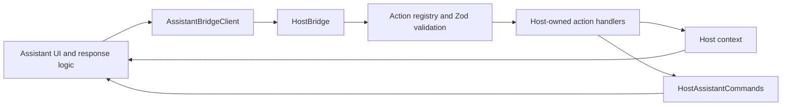

# assistant-bridge

A framework-agnostic integration layer between a host application and an AI assistant. The host defines which actions the assistant can request, publishes application context and sends commands back to the assistant.

The SDK supplies the contracts and execution boundary. The host owns its routes, state, UI and action handlers; the assistant owns conversations and rendering; the backend owns model calls. This package does not include an assistant UI or backend.

> **Beta:** the public API may change before the first stable release.

For an existing chat app, see [the integration guide](docs/existing-chat.md) and `useAssistantIntegration` from `assistant-bridge/react`.

## Installation

```bash
pnpm add assistant-bridge@beta
```

Zod is installed with the package. Add `zod` to your own dependencies only when your code defines action schemas.

| Entry point         | Additional peer dependencies          |
| ------------------- | ------------------------------------- |
| Core                | None                                  |
| `/react`            | `react@^19.3.0`                       |
| `/federation`       | `@module-federation/runtime@2.9.2`    |
| `/react/federation` | Both React and the federation runtime |
| `/ag-ui`            | None                                  |

React applications also supply their renderer, such as React DOM.

> **Security note:** `@ag-ui/client@^1.0.4` takes Zod as a peer dependency (`^3.25.18 || ^4.0.0`), so it shares the patched Zod 4 this package installs. No package-manager override is needed. Remove any `zod` override added for earlier betas.

## Minimal example

```ts
import { createHostIntegration } from 'assistant-bridge';

const integration = createHostIntegration({
  actions: [],
});

integration.updatePage({
  route: '/dashboard',
  page: { title: 'Dashboard', type: 'dashboard' },
});

// Give the assistant only integration.assistantClient.
// Register host actions explicitly before allowing assistant-driven changes.

// When the host integration is no longer needed:
integration.dispose();
```

For a complete integration with an iframe or Module Federation, see the [quick start](docs/quick-start.md).

## How it works



Assistant-to-host actions and host-to-assistant commands use protocol version `1.0.0` and UUID `requestId` values to correlate results. Context notifications do not automatically submit a prompt.

## API overview

<pre>
├─ assistant-bridge (core)
│  ├─ <a href="docs/core.md#create-the-host-integration">createHostIntegration</a>
│  ├─ <a href="docs/core.md#define-host-actions">defineAction, createUiActions</a>
│  ├─ <a href="docs/core.md#update-the-page">updatePage, mapHostEntities</a>
│  ├─ <a href="docs/core.md#use-the-client-inside-the-assistant">AssistantBridgeClient</a>
│  ├─ <a href="docs/core.md#send-commands-from-the-host">assistantCommands</a>
│  ├─ <a href="docs/core.md#connect-an-iframe">connectIframe, connectAssistantIframe</a>
│  ├─ <a href="docs/core.md#connect-a-same-window-assistant">connectEmbeddedAssistant</a>
│  ├─ <a href="docs/core.md#execute-actions-from-the-assistant">createAssistantActionExecutor</a>
│  ├─ <a href="docs/core.md#action-confirmations">createActionConfirmationController</a>
│  ├─ <a href="docs/core.md#action-lifecycle">subscribeActionLifecycle</a>
│  ├─ <a href="docs/core.md#integration-errors">createIntegrationError</a>
│  └─ <a href="docs/core.md#dispose-the-integration">integration.dispose</a>
├─ assistant-bridge/react
│  ├─ <a href="docs/react.md#assistanthost">AssistantHost, useAssistantHost, usePageEntities</a>
│  ├─ <a href="docs/react.md">IntegrationProvider, useIntegration, useOptionalIntegration</a>
│  ├─ <a href="docs/react.md#managed-host-integration">useHostIntegration</a>
│  ├─ <a href="docs/react.md#ui-targets">useUiTarget</a>
│  ├─ <a href="docs/react.md#assistant-panel-behavior">useAssistantPanel</a>
│  ├─ <a href="docs/react.md#unified-assistant-embedding">AssistantEmbed</a>
│  ├─ <a href="docs/react.md#ready-made-iframe-component">AssistantIframe</a>
│  ├─ <a href="docs/react.md#assistant-side-hooks">useAssistantIframeConnection, useAssistantContext, useAssistantCommandHandler</a>
│  └─ <a href="docs/react.md#action-confirmation-ui">useActionConfirmation</a>
├─ assistant-bridge/react/federation
│  └─ <a href="docs/react.md#ready-made-federated-react-component">FederatedAssistant</a>
├─ assistant-bridge/federation
│  └─ <a href="docs/federation.md">connectFederatedAssistant</a>
└─ assistant-bridge/ag-ui
   ├─ <a href="docs/ag-ui.md#agent-client">runWebSocketAgent, WebSocketAgent</a>
   ├─ <a href="docs/ag-ui.md#host-tools-and-context">createHostAgentOptions</a>
   ├─ <a href="docs/ag-ui.md#chat-run-controller">createChatRunController</a>
   ├─ <a href="docs/ag-ui.md#chat-session">createChatSession</a>
   └─ <a href="docs/ag-ui.md#run-errors">describeRunError, RUN_ERROR_CODES</a>
</pre>

## Documentation

- [Quick start](docs/quick-start.md): minimal React host integration
- [Core API](docs/core.md): actions, context, commands, connections and errors
- [React](docs/react.md): provider, hooks and ready-made components
- [Module Federation](docs/federation.md): framework-agnostic remote loading
- [AG-UI client](docs/ag-ui.md): agent client, STOMP and headless chat
- [AG-UI protocol](docs/ag-ui-protocol.md): wire contract for compatible backends
- [Contributing](CONTRIBUTING.md): development, checks and releases

## License

[MIT](LICENSE) © 2026 daino92.
