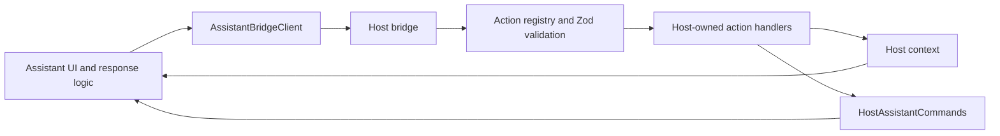

# assistant-bridge

A framework-agnostic integration layer between a host application and an AI assistant. The host defines which actions the assistant can request, publishes application context and sends commands back to the assistant.

The SDK supplies the contracts and execution boundary. The host owns its routes, state, UI and action handlers; the assistant owns conversations and rendering; the backend owns model calls. This package does not include an assistant UI or backend.

> **Beta:** the public API may change before the first stable release; see [API stability](docs/stability.md).

For an existing chat app, see [the integration guide](docs/existing-chat.md) and `useAssistantIntegration` from `assistant-bridge/react`.

## Installation

```bash
pnpm add assistant-bridge@beta
```

Zod is installed with the package. Add `zod` to your own dependencies only when your code defines action schemas.

| Entry point         | Additional peer dependencies          |
| ------------------- | ------------------------------------- |
| Core                | None                                  |
| `/contracts`        | None (Zod only; no runtime)           |
| `/testing`          | None                                  |
| `/react`            | `react@^19.3.0`                       |
| `/federation`       | `@module-federation/runtime@2.9.2`    |
| `/react/federation` | Both React and the federation runtime |

React applications also supply their renderer, such as React DOM.

`assistant-bridge/contracts` holds only the wire contract: message and context schemas, command and action names, error codes and `PROTOCOL_VERSION`. Import it when you need the types or need to validate messages yourself without the runtime.

## Minimal example

A React host describes its pages, wraps the app and declares what the assistant may do:

```tsx
import { z } from 'zod';
import { defineAction, definePageCatalog } from 'assistant-bridge';
import { AssistantHost } from 'assistant-bridge/react';

const pages = definePageCatalog({
  dashboard: { title: 'Dashboard', type: 'dashboard', path: '/' },
  catalog: { title: 'Catalog', type: 'catalog-list' },
});

const App = () => {
  const { pathname } = useLocation();
  const navigate = useNavigate();

  return (
    <AssistantHost
      pages={pages}
      router={{ pathname, navigate: (path) => navigate(path) }}
      actions={() => [
        defineAction({
          name: 'catalog.search',
          description: 'Open the catalog filtered by a search term.',
          schema: z.object({ term: z.string().min(1) }),
          handler: ({ term }) => navigate(`/catalog?search=${encodeURIComponent(term)}`),
        }),
      ]}
    >
      <Routes>{/* … */}</Routes>
    </AssistantHost>
  );
};
```

The assistant now sees the current page, can open catalog pages through `ui.navigate`, and can request `catalog.search`. The SDK validates every request before the handler runs and cleans up on unmount.

Next steps:

- [Host quick start](docs/quick-start.md): targets, page data, permissions and embedding the chat.
- [Chat quick start](docs/chat-quick-start.md): the chat side.

## How it works



Assistant-to-host actions and host-to-assistant commands carry the protocol version (`PROTOCOL_VERSION`, currently `2.0.0`) and UUID `requestId` values to correlate results. Host and assistant check each other's version when they connect; see [protocol versions](docs/core.md#protocol-versions). Context notifications do not automatically submit a prompt.

## API overview

Start with these. Most hosts and chats need nothing else.

<pre>
├─ Host
│  ├─ <a href="docs/react.md#assistanthost">AssistantHost, useAssistantHost</a>              (/react)
│  ├─ <a href="docs/core.md#define-page-catalog">definePageCatalog</a>
│  ├─ <a href="docs/core.md#define-host-actions">defineAction</a>
│  ├─ <a href="docs/react.md#ui-targets">useUiTarget, usePageEntities</a>              (/react)
│  ├─ <a href="docs/react.md#unified-assistant-embedding">AssistantEmbed</a>                            (/react)
│  └─ <a href="docs/core.md#integration-errors">createIntegrationError, ERROR_CODES</a>
└─ Chat
   ├─ <a href="docs/chat-quick-start.md">useAssistantIntegration</a>                   (/react)
   └─ <a href="docs/react.md#action-confirmation-ui">useActionConfirmation</a>                     (/react)
</pre>

<details>
<summary>Advanced: lower-level building blocks</summary>

Use these only when `AssistantHost` or `useAssistantIntegration` does not fit, for example in a host without React. They are the parts those two are built from, and they are more likely to change before 1.0.

<pre>
├─ assistant-bridge (core)
│  ├─ <a href="docs/core.md#create-the-host-integration">createHostIntegration</a>
│  ├─ <a href="docs/core.md#compose-common-ui-actions">createUiActions</a>
│  ├─ <a href="docs/core.md#update-the-page">updatePage, mapHostEntities</a>
│  ├─ <a href="docs/core.md#use-the-client-inside-the-assistant">AssistantBridgeClient</a>
│  ├─ <a href="docs/core.md#send-commands-from-the-host">assistantCommands</a>
│  ├─ <a href="docs/core.md#connect-an-iframe">connectHostIframe, connectAssistantIframe</a>
│  ├─ <a href="docs/core.md#connect-a-same-window-assistant">connectEmbeddedAssistant</a>
│  ├─ <a href="docs/core.md#execute-actions-from-the-assistant">createAssistantActionExecutor</a>
│  ├─ <a href="docs/core.md#action-confirmations">createActionConfirmationController</a>
│  ├─ <a href="docs/core.md#action-lifecycle">subscribeActionLifecycle</a>
│  └─ <a href="docs/core.md#dispose-the-integration">integration.dispose</a>
├─ assistant-bridge/react
│  ├─ <a href="docs/react.md">IntegrationProvider, useIntegration, useOptionalIntegration</a>
│  ├─ <a href="docs/react.md#managed-host-integration">useHostIntegration</a>
│  ├─ <a href="docs/react.md#assistant-panel-behavior">useAssistantPanel</a>
│  ├─ <a href="docs/react.md#ready-made-iframe-component">AssistantIframe</a>
│  └─ <a href="docs/react.md#assistant-side-hooks">useAssistantIframeConnection, useAssistantContext, useAssistantCommandHandler</a>
├─ assistant-bridge/react/federation
│  └─ <a href="docs/react.md#ready-made-federated-react-component">FederatedAssistant</a>
└─ assistant-bridge/federation
   └─ <a href="docs/federation.md">connectFederatedAssistant</a>
</pre>

</details>

## Documentation

- [Host quick start](docs/quick-start.md): a React host with `AssistantHost`
- [Chat quick start](docs/chat-quick-start.md): the chat side of the connection
- [Existing chat](docs/existing-chat.md): adapting a chat that has its own backend protocol
- [Testing a host](docs/testing.md): `connectTestAssistant` for host tests
- [API stability](docs/stability.md): what is public and what may change
- [Core API](docs/core.md): actions, context, commands, connections and errors
- [React](docs/react.md): provider, hooks and ready-made components
- [Module Federation](docs/federation.md): framework-agnostic remote loading
- [Contributing](CONTRIBUTING.md): development, checks and releases

## License

[MIT](LICENSE) © 2026 daino92.
